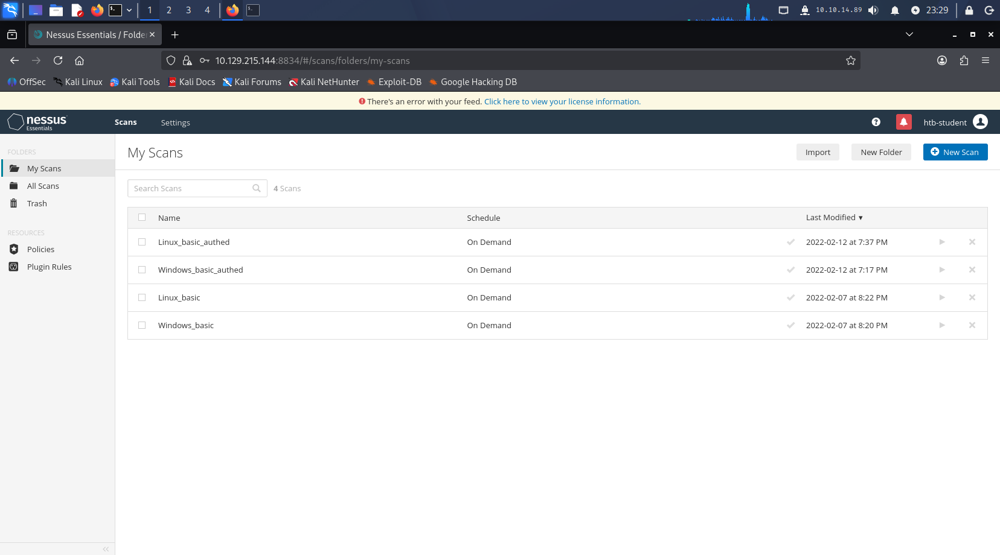
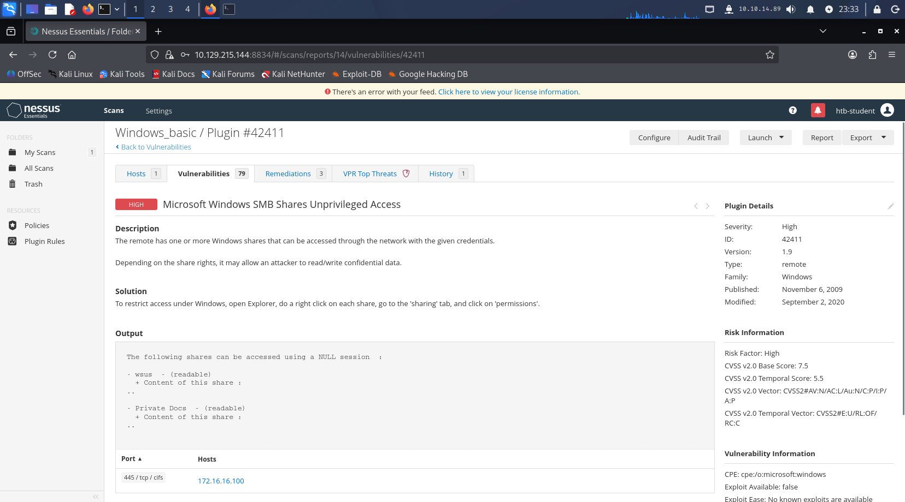
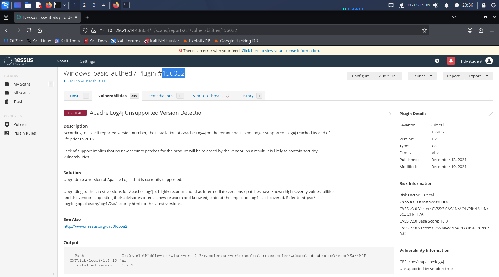
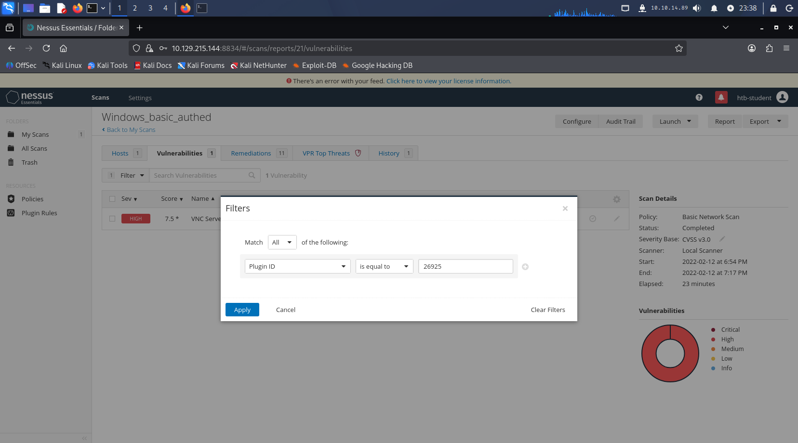
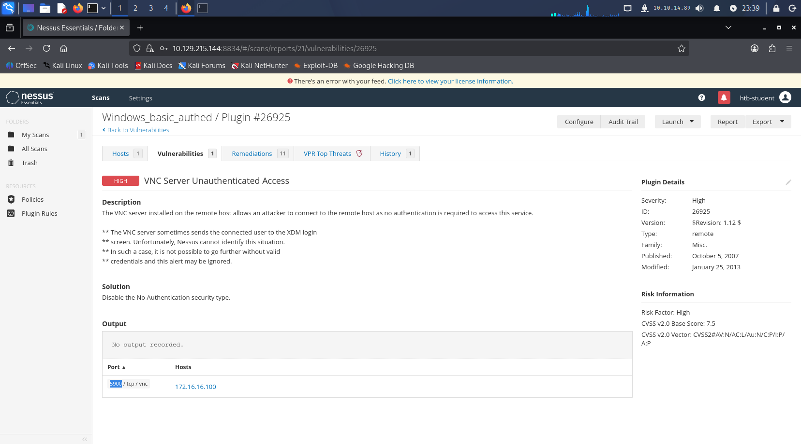

## Nessus Skills Assessment

1. login to nessus using the provided credentials:

  

2. go to the `Windows_basic` scan and find this smb vulnerability:

  

3. at `Windows_basic_authed`, this vulnerability will appear with high count and has a cvss score of 10:

  

4. choose to filter a plugin id.

  

5. this vulnerability with plugin id #26925 will have the vnc server port.

  

