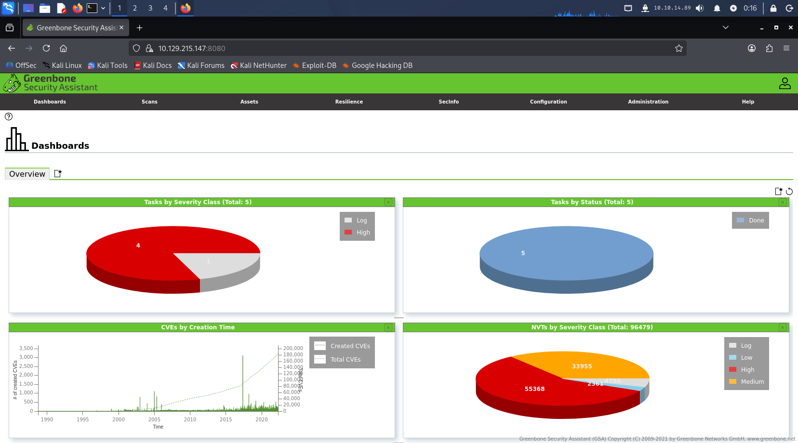
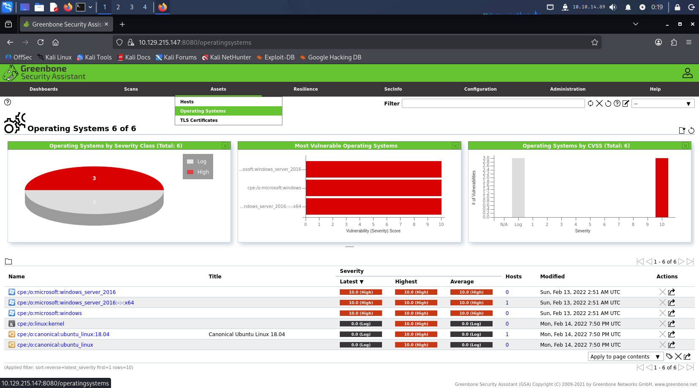
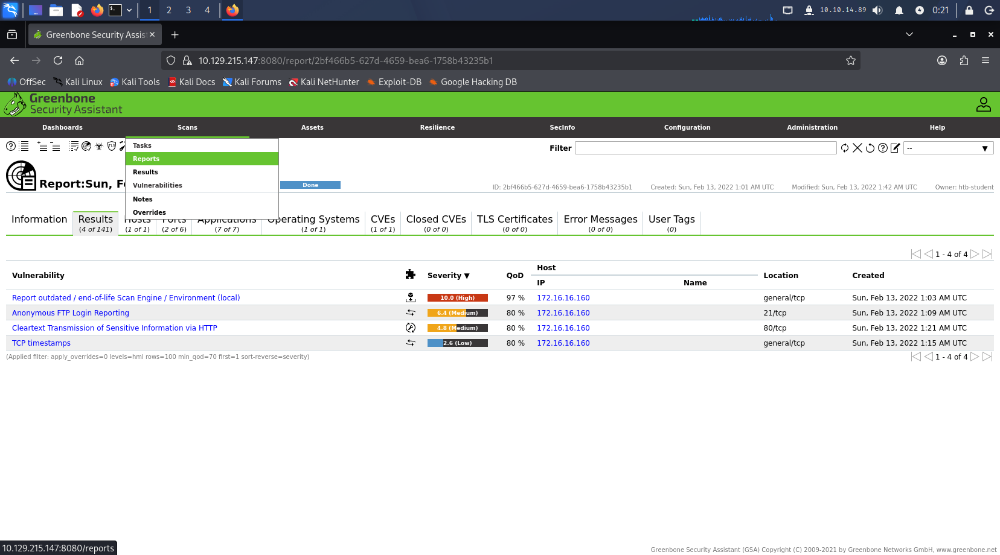
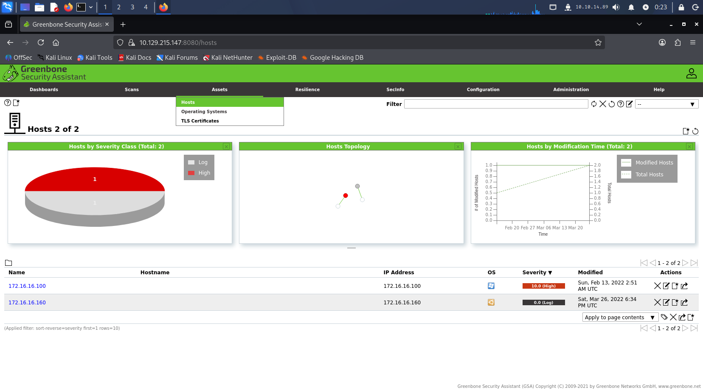
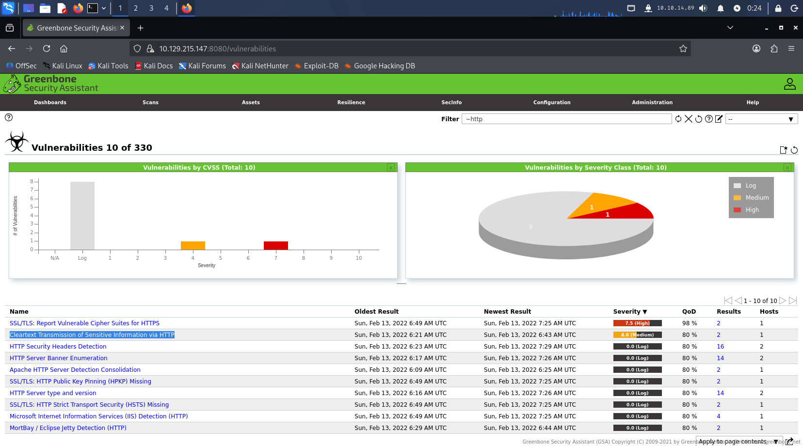

## OpenVAS Skills Assessment

1. login to openvas using the provided credentials:

  

2. identify which linux distribution the linux host is using:

  

3. find the ftp vulnerability on the linux host under scans -> reports.

  

4. find the linux host ip address under assets -> hosts.

  

5. find the http vulnerability by filtering under scans -> vulnerabilities.

  

