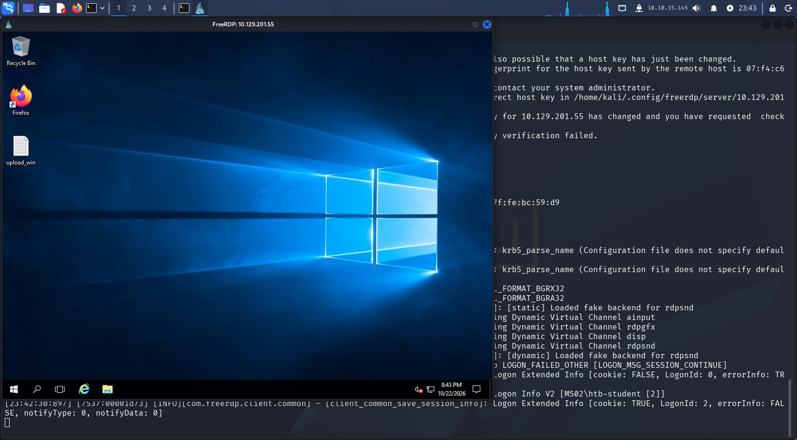
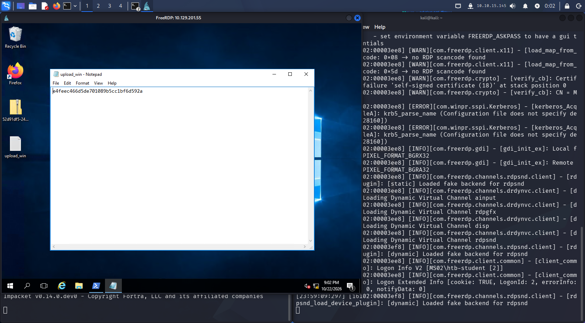

## Windows File Transfer Methods

1. use wget to download `flag.txt` from web root.

```
wget "http://$target_ip/flag.txt"
```

2. start an smb server with kali.

```
sudo impacket-smbserver share -smb2support /tmp/smbshare
```

`share` - the network share that windows will connect to.

`smb2support` - enable smb2 support because windows may have smb1 disabled.

`/tmp/smbshare` - the local directory being shared.

note: make sure that `/tmp/smbshare` has the provided zipfile containing `upload_win.zip`.

3. connect to the windows machine with rdp.

```
xfreerdp /u:htb-student /p:'HTB_@cademy_stdnt!' /v:$target_ip
```

output:
<p align="center">
  
</p>

4. copy the file off the kali smbserver into windows' desktop.

```
PS C:\Users\htb-student\Desktop> Copy-Item "\\$env:ATTACKER_IP\share\52d91df5-24dd-4aa3-b156-8d777b89481e.zip"
```

5. extract the file.

<p align="center">
  
</p>

6. run hasher on `upload_win.txt`.

```
PS C:\Users\htb-student\Desktop> hasher .\upload_win.txt
```