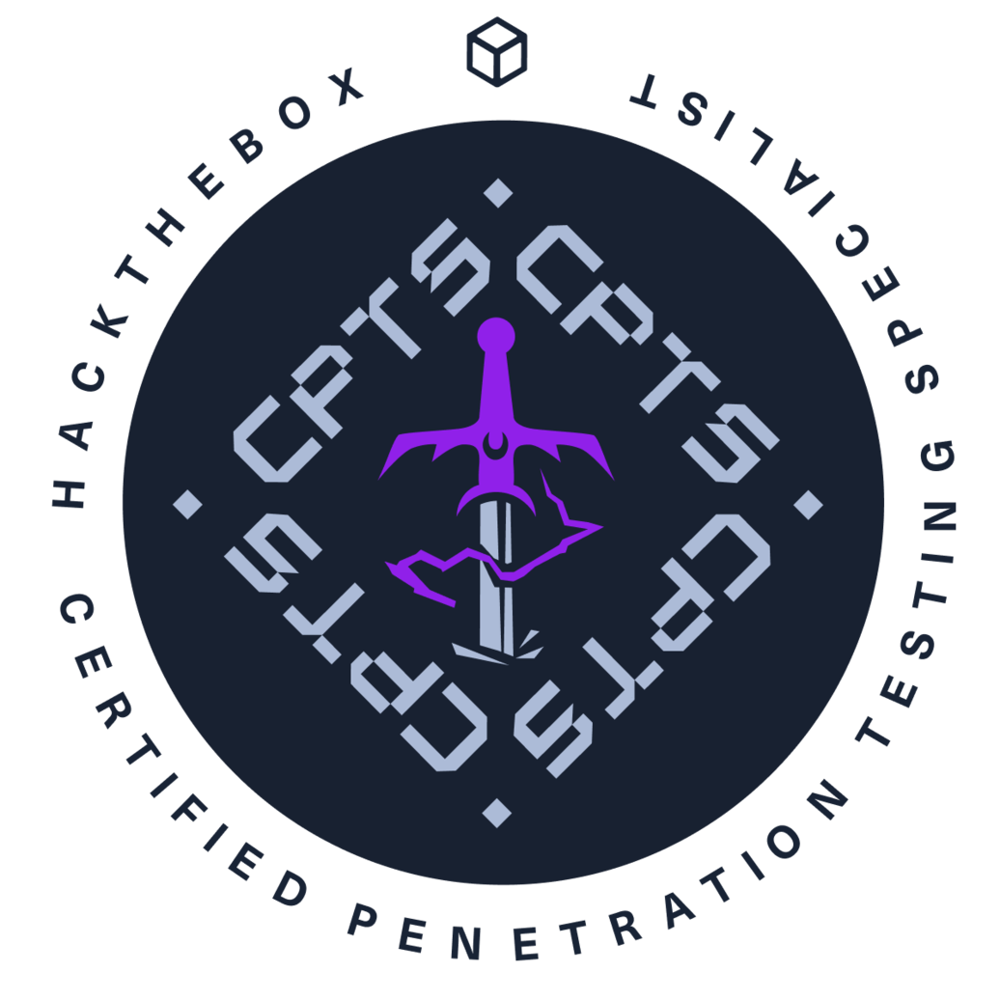

  <table>
    <tr>
      <td>
        
      </td>
      <td align="center">
        <h1>HTB CPTS PREP NOTES</h1>
      </td>
      <td>
        
      </td>
    </tr>
  </table>

Hands-on study notes from Hack The Box Academy's Penetration Tester path, written while working through each module's exercises and skills assessments.

Scope: free-tier modules only, from vulnerability assessment through password attacks.

---

### Path progress

| Folder | Module                         | Status      |
|--------|--------------------------------|-------------|
| 01     | Vulnerability Assessment       | Complete    |
| 02     | File Transfers                 | Complete    |
| 03     | Shells & Payloads              | Complete    |
| 04     | Using the Metasploit Framework | Complete    |
| 05     | Password Attacks               | In progress |

---

### What's in the notes

- Step-by-step notes for each module's exercises and skills assessments.
- Commands as run, with what each flag does and the reasoning behind the step.
- No flag values. Each flag step stops at the command that reads it.

---

## Modules

### Vulnerability Assessment
[`01-vulnerability-assessment/`](01-vulnerability-assessment/)

Two skills assessments, one in Nessus and one in OpenVAS, answering questions about hosts, operating systems, and findings from scan results.

**Tools:** Nessus, OpenVAS

**Covers:** Filtering results by plugin ID, identifying hosts and operating systems, and tracing SMB, FTP, HTTP, and VNC findings

**Status:** Both assessments documented with screenshots

### File Transfers
[`02-file-transfers/`](02-file-transfers/)

Moving files to and from Windows and Linux targets over HTTP, SMB, SCP, and Python.

**Tools:** wget, Impacket smbserver, Python, scp, xfreerdp

**Covers:** Downloading files over HTTP, serving an SMB share from Kali, uploading with scp, and extracting archives on the target

**Status:** Windows and Linux methods documented

### Shells & Payloads
[`03-shells-and-payloads/`](03-shells-and-payloads/)

Bind and reverse shells, Metasploit payload delivery, and web shells, finishing with a live engagement across three hosts.

**Tools:** Netcat, Metasploit, msfvenom, Laudanum, Antak, Burp Suite, Nmap

**Covers:** Bind and reverse shells, EternalBlue against Windows, remote code execution on Linux, ASPX and PHP web shells, and a three-host engagement (Tomcat WAR upload, a custom Metasploit module, EternalBlue)

**Status:** All nine notes, through the live engagement

### Using the Metasploit Framework
[`04-using-the-metasploit-framework/`](04-using-the-metasploit-framework/)

Exploit modules, payloads, sessions and jobs, and Meterpreter against Windows and Linux targets.

**Tools:** Metasploit, Meterpreter, Nmap

**Covers:** EternalRomance, Apache Druid RCE, elFinder RCE with local privilege escalation, FortiLogger file upload, and dumping SAM hashes from a Meterpreter session

**Status:** Four notes: modules, payloads, sessions and jobs, Meterpreter

### Password Attacks
[`05-password-attacks/`](05-password-attacks/)

Cracking hashes, protected files and archives, attacking network services, and extracting credentials from Windows.

**Tools:** John the Ripper, Hashcat, bopscrk, Hydra, NetExec, Evil-WinRM, Impacket, pypykatz, Mimikatz

**Covers:** Hash cracking with John and Hashcat, custom wordlists and rules, protected files and archives (including BitLocker), attacks on WinRM, SSH, RDP, and SMB, default credentials, and the SAM, LSASS, and Credential Manager

**Status:** In progress, notes run through Windows Credential Manager

---

### Notes

All notes are numbered Markdown files inside each module folder, with screenshots in a `screenshots/` subfolder. Each note contains the commands as run, real output, dead ends, and the reasoning behind each step. Target addresses change with every session.

---